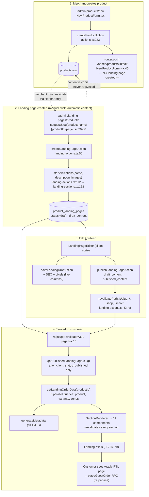

# Deep Audit — Auto-Generated Product Landing Page (`/p/[slug]`)

**Date:** 2026-10-26 · **Scope:** analysis only, no files were modified.
**Focus:** the landing page that is auto-seeded for a product and served at `/p/{slug}`.
**Method:** full read of the renderer, all 11 section components, the admin editor, the landing API layer, the order flow, the SQL migrations (0001–0014), `next.config.mjs`, SEO/tracking files. Every finding below cites `file:line`. Items that cannot be proven from code are marked **UNVERIFIED**.

---

## 0. Premise check (read this first)

The brief says the auto page is *"created automatically the moment a new product is created"*. **That is not what the code does.**

- `createProductAction` → `createProduct` only inserts a `products` row (`src/app/admin/actions.ts:223-250`, `src/lib/api/admin.ts:410-441`). No landing row, no trigger, no queue.
- A repo-wide search for `product_landing_pages` outside the landing files returns **zero** hits. `supabase/migrations/*.sql` contains no `create trigger` on `products` that touches landing tables (only `products_set_updated_at`, `0001:40`).
- The page is created by an explicit admin action — `createLandingPageAction` (`src/app/admin/landing-actions.ts:50-142`) — from `/admin/landing-pages/{productId}`.

What *is* automatic is the **content seed**: the moment the merchant clicks "create", `starterSections()` builds the whole page from the product's name/description/images (`landing-actions.ts:100-122`). That seeded, never-touched page is what this audit treats as "the auto-generated landing page". The rest of the report measures it against a professional sales page.

---

## 1. Executive Summary

### Scores by dimension (0–10)

| Dim | Dimension | Score | One-line verdict |
|---|---|---|---|
| A | Visual Design & UI | **4** | Structurally sound components, but no price above the fold, dead theme controls, placeholder text can go live, zero trust chrome. |
| B | Conversion & Content (CRO) | **3** | The seed page ships with a dummy feature card, no FAQ/testimonials/urgency/proof, generic CTA, weak phone validation, no cross-sell. |
| C | Functionality & Business Logic | **6** | Order engine is genuinely good (atomic stock, server-side pricing, idempotency); but the page never syncs with the product and ISR is never invalidated by product data. |
| D | Responsive & Cross-Device | **6** | Mobile-first grids are correct; mobile preview is fake, one `calc()` is invalid, tables clip and can't be scrolled by keyboard. |
| E | Performance & CWV | **6** | ISR + cookie-free client + React `cache()` are right; LCP image is lazy, 3 queries always run, no `error.tsx`, all 11 sections always bundled. |
| F | SEO & Sharing | **3** | No JSON-LD at all, `/p/*` missing from the sitemap, canonical may be `http://localhost:3000`, no default meta description, no Twitter card. |
| G | Accessibility (WCAG 2.1 AA) | **4** | Not conformant — ~6 clear SC failures (focus visibility, contrast, keyboard-scrollable regions, error association, orphan labels). |
| H | Security & Data Integrity | **7** | RLS, XSS surface and price tampering are well handled; CSP is `unsafe-inline`+`unsafe-eval` and the order RPC has no server-side rate limit. |
| I | Analytics & Tracking | **3** | FB/TikTok only, `ViewContent` carries no product, no `event_id`/CAPI/UTM/consent, no GA/GTM, store-wide pixel setting is dead code. |
| J | Code Quality & Architecture | **4** | Two near-identical order forms already drifting, a 954-line switch, `force-dynamic` list page fetching every row, no component tests (vitest excludes `.tsx`). |
| K | Merchant Experience | **4** | Nothing links product → landing page, no quality checklist, no regenerate button, preview is width-only, no undo/autosave. |
| — | **Overall** | **≈4.6** | A competent *framework* for a landing page with a *non-professional default output* and material SEO/tracking holes. |

### Top 5 critical problems

1. **Money-page CRO failure: no price, no proof, no policy above (or anywhere near) the fold.** The only price on the page lives inside the order summary (`OrderFormSection.tsx:741-774`); the hero renders title + subtitle + CTA only (`HeroSection.tsx:14-27`). No rating, no reviews, no guarantee/COD/returns block, no shipping info, no related products.
2. **The auto-generated content is visibly machine-made.** The starter ships a feature card literally titled **«ميزة»** with empty body (`src/lib/admin/landing-sections.ts:61`), duplicates the product description twice (`landing-actions.ts:112-118` → hero subtitle + `rich_text`), and contains **no** FAQ, testimonials, countdown, size guide or trust section (`landing-sections.ts:154-161`). Placeholder strings («سؤال؟/جواب.», «رأي الزبون», «نص توضيحي») all pass publish validation.
3. **SEO of the store's money pages is close to zero.** No structured data anywhere in the repo (grep `ld+json|schema.org` → 0), sitemap lists `/shop/product/{id}` but never `/p/{slug}` (`src/app/sitemap.ts:32-41`), `NEXT_PUBLIC_SITE_URL` is undocumented and unset in `.env.local.example` → canonical falls back to `http://localhost:3000` (`src/app/p/[slug]/page.tsx:14`), and pages without `seo_description` inherit the site-wide tagline (duplicate meta).
4. **The landing page is a one-time snapshot that silently rots.** No code path ever re-syncs it after a product edit; deleted product images are removed from storage while the live page still points at them (`src/lib/api/admin.ts:600-604`); product/variant/delivery changes never call `revalidatePath('/p/…')` (`src/app/admin/actions.ts:216-221`) so price and stock can be wrong for 5 minutes.
5. **Ad attribution is structurally broken.** `ViewContent` fires with only `{currency:"DZD"}` (`OrderFormSection.tsx:229`), `Purchase` has no `content_ids`/`order_id`/`event_id` (`OrderFormSection.tsx:232-237`), no UTM capture, no consent gate, no GA/GTM, and the store-wide pixel configured in admin is never injected (`src/app/layout.tsx:33-35` TODO).

**Runner-up (Critical):** publishing a landing page makes it the canonical product URL via a redirect (`src/app/shop/product/[...slug]/page.tsx:52`), which *removes* everything the catalog page did better — price+discount badge, star rating, approved reviews, hover-zoom gallery, tabs, related products, navbar/footer/contact.

---

## 2. System Map

### 2.1 Flow diagram

### 2.2 Relevant files

| Layer | Files |
|---|---|
| Public route | `src/app/p/[slug]/page.tsx`, `src/app/p/[slug]/not-found.tsx` |
| Renderer | `src/components/landing/SectionRenderer.tsx`, `RichText.tsx`, `LandingPixels.tsx` |
| Sections (11) | `src/components/landing/sections/{Hero,Gallery,Features,SizeGuide,BeforeAfter,Testimonials,Faq,Countdown,RichText,OrderForm,StickyCta}Section.tsx`, `SectionShell.tsx` |
| Schemas/theme | `src/lib/landing/{sections,content,theme,theme-css,rich-text,order-data,api,pixels,tracking}.ts` |
| Admin actions | `src/app/admin/landing-actions.ts` (638 L), `src/app/admin/actions.ts` (product/variant/image/delivery) |
| Admin editor | `src/app/admin/(dashboard)/landing-pages/**` (`LandingPageEditor.tsx`, `SectionsPanel.tsx`, `SectionFields.tsx` 954 L, `InspectorPanel.tsx`, `SettingsPanel.tsx`, `TemplatesMenu.tsx`, `LivePreview.tsx`, `CreateLandingPageForm.tsx`, `preview/page.tsx`), `landing-templates/**` |
| Admin lib | `src/lib/admin/{landing-validation,landing-sections,landing-preview,landing-asset,product-validation,image-dimensions}.ts` |
| Order flow | `src/components/landing/sections/OrderFormSection.tsx` (818 L), `src/lib/api/orders.ts`, `src/lib/checkout/validation.ts`, `src/lib/{pricing,delivery,quantity,idempotency,rate-limit}.ts` |
| DB | `supabase/migrations/0011_landing_pages.sql`, `0012_guest_note.sql` (`place_guest_order`), `0013`, `0014`, `0001`, `0006` |
| SEO/perf/config | `src/app/{layout.tsx,sitemap.ts,robots.ts}`, `next.config.mjs`, `src/styles/fonts/index.ts` |
| Comparison (catalog page) | `src/app/shop/product/[...slug]/page.tsx`, `src/components/product-page/**` |
| i18n | `src/lib/store/i18n-ar.ts` (customer), `src/lib/admin/i18n-ar.ts` (admin) |
| Tests | `src/components/landing/__tests__/*`, `src/lib/landing/__tests__/*`, `src/lib/admin/__tests__/landing-*` |

### 2.3 Product fields that feed the page

**Actually used**

| Source | Field | Where it lands |
|---|---|---|
| `products` | `name` | hero title (`landing-actions.ts:115`), SEO title fallback (`page.tsx:25`), gallery alts n/a |
| `products` | `description` | hero subtitle (300 chars) + `rich_text` body (4000 chars) — **same text twice** (`landing-actions.ts:116-117`) |
| `products` | `base_price`, `discount_percentage`, `discount_amount` | order summary only, live query (`order-data.ts:90-98`) |
| `products` | `is_active` | makes `getLandingOrderData` null → "غير متوفر" box (`api.ts:147-152`) |
| `products` | `size_type` | only to sort size buttons (`OrderFormSection.tsx:120`) |
| `product_images` | `url`, `position` | hero + gallery, **copied once** at creation (`landing-actions.ts:100-108`) |
| `product_variants` | `color`, `color_hex`, `size`, `price`, `stock_quantity` | option pickers, stock line, per-variant price |
| `delivery_zones` | wilaya names + `home_price`/`office_price` | delivery selector + totals |
| `product_landing_pages` | `draft_content`/`published_content` (theme + 11 section types), `seo_*`, `og_image_url`, `*_pixel_id` | everything else |
| `reviews` | — | **not used on `/p/*`** (only the catalog page reads them, `shop/product/[...slug]/page.tsx:61`) |

**Missing from the product model but required by a professional sales page**

benefits/key selling points · bullet specs (material, weight, care) · FAQ pairs · video URL · badge set (COD, delivery time, returns, warranty, secure order) · per-variant gallery · compare-at price rendered as struck-through anchor · delivery ETA per wilaya · size-chart data (a section exists but nothing seeds it) · review feed integration · SEO title/description/OG auto-derivation · share image · related/cross-sell product ids · slug (transliterated, editable) · `alt_text` for landing images (exists on `product_images.alt_text` but is never copied — `landing-actions.ts:102` selects only `url, position`).

### 2.4 Auto flow vs. the other product page

There is only **one** landing-page builder; "manual" vs "auto" differ only in how much of `draft_content` the merchant replaced after the seed. The genuinely different page type is the **catalog product page**:

| | Catalog `/shop/product/{uuid}` | Landing `/p/{slug}` (auto-seeded) |
|---|---|---|
| Price + discount badge above fold | ✅ `product-page/Header/index.tsx:163-184` | ❌ only inside order summary |
| Star rating + approved reviews | ✅ `Header/index.tsx:150-162`, `Tabs/index.tsx:49` | ❌ |
| Gallery zoom / selectable colors | ✅ `PhotoSection.tsx:28-51` (`hover:scale-110`, `priority`) | ❌ static square grid |
| FAQ / details tabs | ✅ (though copy is template text) | ❌ not seeded |
| Related products | ✅ `shop/.../page.tsx:76-82` | ❌ |
| Navbar, footer, contact, legal | ✅ `StorefrontChrome.tsx:21-26` | ❌ stripped (`:18-20`) |
| Theming, sticky CTA, countdown, pixels, ISR | ❌ | ✅ |

**Key structural finding:** once a landing page is published, the catalog URL **redirects** to `/p/{slug}` (`shop/product/[...slug]/page.tsx:52`), so the landing page inherits all of its own gaps — and loses every ✅ above. The auto page is therefore the *only* page most customers will ever see.

---

## 3. Findings Table

Severity: **Critical** > **High** > **Medium** > **Low**. Effort: **S** < 1 day · **M** ≈ 1–3 days · **L** ≥ 1 week.

### A — Visual Design & UI

| ID | Sev | Problem | Evidence | Impact | Fix | Effort |
|---|---|---|---|---|---|---|
| LP-001 | Critical | Nothing above the fold shows price, discount or rating; hero is title+subtitle+CTA only | `HeroSection.tsx:14-27`; price only at `OrderFormSection.tsx:741-774` | Ad bounce, poor ad relevance/quality score | Add a price block (price + struck original + discount pill + rating) into the hero | S |
| LP-002 | Critical | If no section survives validation the whole page renders blank (pixels only) | `SectionRenderer.tsx:76` `if (nodes.length === 0) return null;` + `page.tsx:86` | Customer sees a white screen on a paid click | Render a fallback (product name + order form) or `notFound()` + admin alert | S |
| LP-003 | High | Placeholder Arabic defaults are publishable customer-facing copy | `landing-sections.ts:47,61,66,78,83,94` («عنوان رئيسي», «ميزة», «سؤال؟/جواب.», «رأي الزبون», «نص توضيحي») all pass `pageContentSchema` (`content.ts:20-46`) → `buildPublishUpdate` (`landing-validation.ts:179-193`) | Instant credibility loss | Reject placeholder strings at publish; flag sections containing only defaults | S |
| LP-004 | High | The auto starter's `features` card is literally «ميزة» with empty body | `landing-sections.ts:61` `items: [{ title: "ميزة", text: "" }]`, always added by `starterSections` (`:154-161`) | Every new page is born with lorem-ipsum | Seed features from description bullets or omit the section when empty | S |
| LP-005 | High | Theme controls `pageBgColor`, `textColor`, `baseFontSize` are emitted but never consumed by the public page | defined `theme-css.ts:17,18,22`; only consumer is admin preview `LivePreview.tsx:141`; public `page.tsx:53-56` only spreads vars | Merchant sees change in preview, customer does not — false confidence | Apply `background:var(--lp-bg); color:var(--lp-text); font-size:var(--lp-font-size)` on `<main>` | S |
| LP-006 | High | Hardcoded text colors fight the theme (white on `--lp-primary`, `#111111` on `--lp-accent`) | `HeroSection.tsx:11,14,18`, `CountdownSection.tsx:43`, `OrderFormSection.tsx:423` `bg-white text-black` | Unreadable sections for common theme choices | Derive text color from background luminance or constrain the palette | M |
| LP-007 | High | Gallery has no zoom, no lightbox, no thumbnails, and forces square crop | `GallerySection.tsx:15-27` `aspect-square object-cover`; no `lightbox\|zoom` anywhere in `src/components/landing` | Fashion buyers can't inspect the product → lost sales | Add click-to-zoom lightbox; keep natural aspect | M |
| LP-008 | High | No brand chrome at all: no logo, phone/WhatsApp, contact, privacy/terms on `/p/*` | `StorefrontChrome.tsx:18-20` strips navbar+footer for `/p/`; no landing section renders contact/legal | Trust + common ad-policy requirement (privacy link) missing | Add a minimal footer bar (logo, phone, legal links) to the landing layout | M |
| LP-009 | Medium | Invalid sections are silently dropped with no log and no admin warning | `SectionRenderer.tsx:56-60` `if (!parsed.success) return;` | Stored content disappears for customers, undiagnosable | Log server-side + surface "N sections hidden" in the editor (preview already does: `LivePreview.tsx:109-122`) | S |
| LP-010 | Medium | Empty/blank bands render when props are empty (rich text `""`, size-guide row `["",""]`) | `sections.ts:16` `shortText` allows `""`; `RichTextSection.tsx:15-17`; `SizeGuideSection.tsx:29-40` | Dead white space on a sales page | Hide sections whose content is empty after trim | S |
| LP-011 | Medium | Auto alt text is generic («صورة 1») because the seed writes `alt: ""` | `landing-sections.ts:54,56` `alt: ""` → `GallerySection.tsx:20` fallback | a11y + image SEO loss | Copy `product_images.alt_text` (already a column) into the seed | S |
| LP-012 | Medium | No blur/LQIP placeholder, images pop in | no `blurDataURL\|placeholder` in `src/components/landing` (width/height present → CLS-safe) | Janky on slow mobile | Add `placeholder="blur"` with a tiny data URI | S |
| LP-013 | Medium | Section rhythm is one blunt doubled padding variable — no alternating backgrounds/dividers | `SectionShell.tsx:19` `py-[var(--lp-section-spacing)]`, default 48 → 96px between sections (`theme.ts:32`) | Reads as an unstyled template | Alternate shell backgrounds / add dividers | M |
| LP-014 | Medium | Testimonials have zero authenticity markers (no date, no "verified", no avatar required) | `TestimonialsSection.tsx:16-44`; `sections.ts:115` self-declared rating | Testimonials look fabricated | Add date + verified flag; later link to real reviews | M |
| LP-015 | Low | Typography scale ad-hoc; theme font-size knob unused | `HeroSection.tsx:14` `text-2xl sm:text-4xl` vs all other `text-xl sm:text-2xl` | Weak hierarchy | Drive sizes from `--lp-font-size` | S |
| LP-016 | Low | Almarai loads `subsets:["arabic"]` only (no latin) while Cairo/Tajawal include latin | `src/styles/fonts/index.ts:52-57` vs `:38-50` | Mixed-script glyph fallback on Almarai pages | Add `"latin"` subset | S |

### B — Conversion & Content (CRO)

| ID | Sev | Problem | Evidence | Impact | Fix | Effort |
|---|---|---|---|---|---|---|
| LP-017 | Critical | Price never appears outside the order form (see LP-001) | `OrderFormSection.tsx:741-774` is the only price render; `order.name`/`product` never rendered | Bounce on paid traffic | Hero price block + sticky bar price | S |
| LP-018 | High | Seed page contains no FAQ, testimonials, countdown, size guide or trust section | `landing-sections.ts:154-161` order = hero, gallery, rich_text, features, order_form, sticky_cta | No objection handling, no proof, no urgency by default | Seed a richer default (FAQ from product, trust badges, delivery info) | M |
| LP-019 | High | No strike-through original price / discount badge on the landing page | `OrderFormSection.tsx:751-758` shows only `-{discount}`; catalog does it right `Header/index.tsx:163-184` | Lost anchoring & urgency | Render `Price` + line-through original + % pill in hero | S |
| LP-020 | High | No cross-sell / related products section type exists | `sections.ts:189-201` (11 types, none related); catalog has it `shop/.../page.tsx:76-82` | Single-exit funnel, no AOV upside | Add `related_products` section fed by `getPublishedLandingSlugMap` | M |
| LP-021 | High | No real reviews/rating on the page that gets all the ad spend | `TestimonialsSection` = admin text; `getApprovedReviews` used only by catalog `shop/.../page.tsx:61` | Weakest social proof where it matters most | New section reading approved `reviews` + aggregate rating | M |
| LP-022 | High | No shipping / returns / guarantee / COD reassurance block | only fine print `OrderFormSection.tsx:773` `ar.checkout.codNote`; policy copy exists `i18n-ar.ts:297-306` but unreachable on `/p/*` | COD buyers bounce on delivery/return questions | Add trust section + footer links | S |
| LP-023 | High | Phone validation is ≥8 digits, not Algerian 10-digit `05/06` | `checkout/validation.ts:13-18`; test asserts 8 digits pass (`checkout-validation.test.ts:21`) | Failed contact → undeliverable orders | Enforce `^(05\|06)\d{8}$` (client + server) | S |
| LP-024 | High | Description duplicated verbatim (hero subtitle = first 300 chars = rich_text body) | `landing-actions.ts:112-118` passes same `description` as `subtitle` and `text` | Obvious machine-generated page | Generate distinct copy (subtitle = first sentence; body = full) or drop one | S |
| LP-025 | Medium | No commune/commune-level address (free-text address only) | grep `commune\|بلدية` → 0; wilaya select `OrderFormSection.tsx:617-638` | Imprecise addresses → failed first delivery (major COD cost) | Add commune selector (roadmap item already in `docs/PROJECT_OVERVIEW.md:20`) | L |
| LP-026 | Medium | Delivery price shows «—» until a wilaya is picked; `showShipping:false` silently falls back to home delivery | `OrderFormSection.tsx:766`, `:217-219` | Total unknown at decision moment | Show zone hint + always expose delivery options | S |
| LP-027 | Medium | Order summary has no product image/name — last screen doesn't confirm what is bought | numeric-only summary `OrderFormSection.tsx:741-774`; `order.name` unused; catalog shows thumbnail `OrderForm.tsx:248-258` | Confidence dip at commitment | Add product line to summary | S |
| LP-028 | Medium | Submit button doubles as error/status label («نفدت الكمية», «تعذّر تحميل خيارات التوصيل.») | `OrderFormSection.tsx:800-805` | CTA stops reading as an action | Separate status line (`role="status"`), keep button label | S |
| LP-029 | Medium | CTA copy is generic everywhere: «اطلب الآن» | `sections.ts:30,176,185`; `landing-sections.ts:49,100,103` | Weaker click motivation | Default to «اطلب الآن — {price} DA» | S |
| LP-030 | Medium | Sticky mobile bar has no price, no timer, no stock; `md:hidden` leaves tablets with nothing | `StickyCtaSection.tsx:41-48` | Under-optimized mobile CTA | Add price + product name to the bar; extend to `lg` | S |
| LP-031 | Medium | Countdown dies permanently showing «انتهى العرض» (never hides) | `CountdownSection.tsx:46-47`; default `endAt = now+3d` set at creation `landing-sections.ts:85-92` | Urgency becomes embarrassment on any page older than 3 days | Auto-hide when expired; prompt merchant to reset | S |
| LP-032 | Medium | Stock line shows for *any* stock and is served from a 5-min ISR cache | label for any value (`sections.ts:174` `showStock` default true); `page.tsx:16` `revalidate = 300` | «المتبقي 100 قطعة» kills urgency; stale stock can oversell | Only show below a threshold; move stock to a client fetch | M |
| LP-033 | Medium | Hero CTA `#order-form` can be a dead anchor and jumps harshly | `HeroSection.tsx:22-27` (no target guard, unlike `StickyCtaSection.tsx:19-26`); no `scroll-behavior: smooth` in `globals.css` | CTA click appears broken | Guard the link + `scrollIntoView({behavior:"smooth"})` | S |
| LP-034 | Medium | Hard `slice()` truncation can cut mid-word/mid-sentence | `landing-actions.ts:115-116` `.slice(0,120)` / `.slice(0,300)` | Broken-looking hero copy | Word-boundary truncation with ellipsis | S |
| LP-035 | Medium | No delivery ETA per wilaya (zones only carry prices) | `order-data.ts:46-53` | Unknown delivery time at checkout | Store `eta_days` on `delivery_zones` and render | M |
| LP-036 | Low | No tax line / free-shipping messaging (N/A for DZ but copy exists unused) | `i18n-ar.ts` legal shipping copy; no consumer on `/p/*` | Minor | Surface policy line under the form | S |

### C — Functionality & Business Logic

| ID | Sev | Problem | Evidence | Impact | Fix | Effort |
|---|---|---|---|---|---|---|
| LP-037 | High | Landing content is never regenerated when the product changes (title, description, price copy all go stale) | only writer of `product_landing_pages` is `landing-actions.ts` (grep); `updateProductAction` (`actions.ts:252-281`) touches only `revalidateProductPaths` (`:216-221`) | Inconsistent page: old title, new price | «تحديث من المنتج» action + optional auto-sync of hero/rich_text | M |
| LP-038 | High | Deleting a product image removes the storage object while the live page still references it | `src/lib/api/admin.ts:600-604` `storage.remove([path])`; landing stores raw URLs (`landing-actions.ts:106-108`) | Broken images on the money page | Reference images by id at render, or block deletion when referenced | M |
| LP-039 | High | Product/variant/delivery changes never revalidate `/p/{slug}` → price, stock and delivery wrong for up to 5 min | `actions.ts:216-221`, `:621-622`, `:710-711` (no `/p/`); only landing publish does (`landing-actions.ts:42-48`) | Customer orders at an outdated price/stock | Add `revalidateProductLandingPaths(productId)` to those actions | S |
| LP-040 | High | Admin draft-preview places **real orders** (missing `preview` prop) | `preview/page.tsx:49` `<SectionRenderer sections={…} order={order} />` — no `preview`; gate is `OrderFormSection.tsx:279,794`; `LivePreview.tsx:158` passes it correctly | Test orders pollute the DB and stock | Pass `preview` (and reserve sticky-CTA padding) | S |
| LP-041 | Medium | Deactivated product's landing page stays publicly reachable (200 with full content) | `getPublishedLandingPage` has no `is_active` check (`api.ts:56-79`); only order data nulls out (`:147-152`) | "Removed" offers keep ranking and dead-end shoppers | Join `products(is_active)` and `notFound()` when inactive | S |
| LP-042 | Medium | Arabic product names collapse to `offer`, `offer-2`, `offer-3`… | `landing-validation.ts:35-47`; test `landing-validation.test.ts:36` `suggestSlug("حقيبة يد") === "offer"`; DB CHECK ASCII-only (`0011:50-51`) | Non-descriptive, un-shareable URLs; bad SEO | Transliterate ar→latin or append product-id suffix | M |
| LP-043 | Medium | Slug is immutable and there is no delete action for a landing page | no `update(… slug …)` anywhere (grep); only `unpublishLandingPageAction` (`landing-actions.ts:307`) | A typo'd slug is permanent; page can't be retired | Allow slug edit with redirect table + a delete action | M |
| LP-044 | Medium | `createLandingPageAction` inserts `draft_content` **without** the strict validator used everywhere else | `landing-actions.ts:124-133` (raw insert) vs `saveLandingDraftAction:166-167` (`validateContentInput`) | Imageless products get `gallery: {images: []}` → invalid (`sections.ts:46`) → save/publish fail with a generic error | Validate before insert; skip empty gallery in the seed | S |
| LP-045 | Medium | SEO + pixel fields bypass the draft→publish gate and are not revalidated on save | `saveLandingDraftAction` writes live columns `landing-actions.ts:169-183`; `contentEquals` compares only `{theme,sections}` (`landing-validation.ts:220-227`); no `revalidatePath('/p/…')` at `:190` | Saving a draft instantly changes live metadata while the UI says «لا توجد تغييرات» | Add `draft_seo_*` columns copied on publish; revalidate on save | M |
| LP-046 | Medium | No optimistic locking between save and publish (lost updates) | `publishLandingPageAction` reads then writes without `updated_at` guard (`landing-actions.ts:282-298`); same in save (`:176-186`) | Two admins → last write wins; publish can ship an older draft | Compare `updated_at` and return a conflict error | S |
| LP-047 | Medium | Idempotent replay ignores changed customer fields | reuse keyed only on `variantId`+`quantity` (`OrderFormSection.tsx:316-320`); server replay returns the stored order without comparing name/phone/address (`0012:64-80`) | User "fixes" phone and still gets the old order | Include a payload hash in the key/RPC | S |
| LP-048 | Medium | Client can display a negative total when `discount_amount > base_price` | `pricing.ts:30-42` uncapped; `OrderFormSection.tsx:221-224`; DB allows any `discount_amount >= 0` (`0001:31`); server floors to 0 (`0012:282-283`) | Quoted price ≠ charged price | Cap discount at unit price in `getDiscountAmount` + DB CHECK | S |
| LP-049 | Low | Admin error normalizer echoes raw PostgREST message/details/hint | `action-errors.ts:42-46` | Internal schema details shown to admins | Map to friendly strings only | S |
| LP-050 | Low | Slug uniqueness race returns a generic DB error | pre-check `landing-actions.ts:92-98` then unique constraint `0011:49` → `23505` mapped in `action-errors.ts:10` | Confusing message on concurrent creates | Catch `23505` → «الرابط مستخدم» (already generic) + retry hint | S |
| ✅ | — | **Verified strengths:** atomic `FOR UPDATE` stock locking with no oversell (`0012:214-269`); price/discount/delivery fully recomputed server-side (`0012:243-305`); idempotency key + unique-violation replay (`0012:64-80`); qty caps enforced in 3 places (`quantity.ts:2`, `0012:229,236`); coupons confirmed out of scope. | | | | |

### D — Responsive & Cross-Device

| ID | Sev | Problem | Evidence | Impact | Fix | Effort |
|---|---|---|---|---|---|---|
| LP-051 | High | Admin "mobile" preview is width-only, not an iframe — media queries still resolve against the real browser | `LivePreview.tsx:17-25,67-80` (`width:390` + `transform:scale`); app admits it `i18n-ar.ts:420-421` | Merchant never sees the true phone layout; `md:hidden` sticky bar never previews | Render preview in a real `<iframe>` | M |
| LP-052 | High | Invalid `calc()` silently drops the safe-area padding on the sticky bar | `StickyCtaSection.tsx:41` `pb-[calc(0.75rem+env(safe-area-inset-bottom))]` (no spaces → invalid CSS). Correct pattern exists at `page.tsx:74` and `product-page/OrderForm.tsx:469` | iOS home-indicator overlap once `viewport-fit` is set | `pb-[calc(0.75rem_+_env(safe-area-inset-bottom))]` | S |
| LP-053 | High | Size-guide table clips on phones and cannot be scrolled by keyboard | `SizeGuideSection.tsx:14-15` `overflow-x-auto` + `min-w-[480px]` on a ~343px container, wrapper not focusable | Mobile users lose columns; WCAG 2.1.1 failure | `tabIndex={0}` + `role="region"` + `aria-label`, or responsive stacked cells | S |
| LP-054 | Medium | Quantity stepper buttons are exactly 24×24 px | `OrderFormSection.tsx:523,535` `h-6 w-6` | Below comfortable touch target (WCAG 2.2 2.5.8 marginal) | `h-11 w-11` | S |
| LP-055 | Medium | No `break-words`/`overflow-wrap` on landing text | no `break-words` in `src/components/landing` (grep) | Long URLs/tokens overflow `max-w-3xl` | Add `break-words` to shells | S |
| LP-056 | Low | Discount minus sign sits outside `<bdi dir="ltr">` → renders `1200.00 DA-` in RTL | `OrderFormSection.tsx:754-756` vs correct catalog pattern `Header/index.tsx:176` | Visual glitch on the total | Move `-` inside the `<bdi>` | S |
| LP-057 | Low | Editor sticky header doesn't wrap at tablet widths | `LandingPageEditor.tsx:268` inner flex, 4 `shrink-0` children `:277-289` | Chips overflow 768–1024px | `flex-wrap` | S |
| ✅ | — | **Verified strengths:** all section grids are genuinely mobile-first (`HeroSection.tsx:12`, `GallerySection.tsx:15`, `FeaturesSection.tsx:15`); no physical `left/right/ml/mr` utilities in landing components; `<html lang="ar" dir="rtl">` (`layout.tsx:31`); prices wrapped in `<bdi dir="ltr">` (`Price.tsx:14`); countdown forces `dir="ltr"` (`CountdownSection.tsx:51`). | | | | |

### E — Performance & Core Web Vitals

| ID | Sev | Problem | Evidence | Impact | Fix | Effort |
|---|---|---|---|---|---|---|
| LP-058 | Critical | Schemas accept any `https://` image but `next/image` only allows `*.supabase.co` → published page can 500, and `/p/*` has **no** `error.tsx` | `sections.ts:10-13` + free-text field `SectionFields.tsx:107-121` vs `next.config.mjs:28-30`; glob `src/app/**/error.tsx` → only admin + shop | A pasted external image kills the money page with a stock English 500 | Validate hosts at save time; add `src/app/p/[slug]/error.tsx` | S |
| LP-059 | High | Hero (LCP) image is force-lazy with no `priority` | `HeroSection.tsx:35` `loading="lazy"`; grep `priority` → nothing in `src/components/landing` (catalog does it: `PhotoSection.tsx:53`) | Inflated LCP on ad pages | `priority` + `loading="eager"` on the hero | S |
| LP-060 | High | `NEXT_PUBLIC_SITE_URL` undocumented and unset → canonical `http://localhost:3000`, sitemap `https://example.com` | `page.tsx:14`, `layout.tsx:9,12`, `sitemap.ts:5`, `robots.ts:4`; absent from `.env.local.example` (verified) | Wrong canonical/sitemap in production **UNVERIFIED** (may be set in host env) | Document + require the var; fail the build if missing | S |
| LP-061 | Medium | 3 order-data queries + ~48 delivery zones fetched even when the page has no order form | `page.tsx:49-51` unconditional; `api.ts:140-165` | Wasted work on every revalidation, ×10k pages | Skip when no visible `order_form` section | S |
| LP-062 | Medium | `SectionRenderer` statically imports all 11 sections → the 818-line `OrderFormSection` is always bundled | `SectionRenderer.tsx:4-14,24-36` | Larger JS on every landing page | `next/dynamic` per section type | M |
| LP-063 | Medium | Up to 3 Arabic font families (8 weight files) load; Cairo is forced onto `<body>` site-wide | `fonts/index.ts:38-57`; `layout.tsx:32` `<body className={cairo.className}>`; `page.tsx:72-77` attaches all 3 variables | Extra font downloads + Arabic metric swap (FOUT/CLS) | Load only the theme's fonts; drop the unused family | M |
| LP-064 | Medium | Every content doc is Zod-parsed ~3× per request | `content.ts:56`, `SectionRenderer.tsx:56`, plus each component (`HeroSection.tsx:6`, `OrderFormSection.tsx:59`, …) | CPU per render; symptom of untyped boundaries | Parse once at the boundary, pass typed sections down | M |
| LP-065 | Medium | `getPublishedLandingSlugMap()` ships every published row to home/search/shop on every request (force-dynamic) | `api.ts:109-126`; called `page.tsx:16`, `search/page.tsx:17`, `shop/page.tsx:57`; home is `force-dynamic` (`page.tsx:9`) | Unbounded payload at 10k products | `unstable_cache` + pagination, or store the slug on `products` | M |
| LP-066 | Medium | Pixel snippets are raw inline `<script>`, not `next/script` | `LandingPixels.tsx:21-32`; grep `next/script` → 0 hits | May not execute on client-side navigation → silently lost events (**UNVERIFIED**, needs runtime check) | Migrate to `next/script strategy="afterInteractive"` | S |
| LP-067 | Low | Root chrome is a `"use client"` component importing Navbar+Footer into every route's client graph | `StorefrontChrome.tsx:1,17-20` | Dead client JS shipped to `/p/*` | Split into server-visible branches | S |
| LP-068 | Low | No `generateStaticParams` → first visitor pays SSR + 4 queries + image optimization | `page.tsx` (grep `generateStaticParams` → 0) | Cold-start latency on the first ad click | Pre-generate top slugs or accept on-demand ISR | S |
| ✅ | — | **Verified strengths:** ISR configured and not broken by dynamic APIs (`page.tsx:16`; cookie-free anon client `api.ts:18-35`; middleware matcher is `/admin` only `middleware.ts:71-73`); React `cache()` dedupes metadata+page (`api.ts:52`); all images carry `width`/`height` (CLS-safe); `framer-motion` not reachable from `/p/*`; Supabase order client dynamically imported on submit (`OrderFormSection.tsx:331-333`). | | | | |

### F — SEO & Sharing

| ID | Sev | Problem | Evidence | Impact | Fix | Effort |
|---|---|---|---|---|---|---|
| LP-069 | Critical | **No structured data anywhere** — no `Product`/`Offer`/`AggregateRating`/`FAQPage` JSON-LD | repo grep `ld+json\|schema.org\|JSON-LD` → **0 matches** | No rich results, no machine-readable price/availability, weaker ad matching | Emit `Product`+`Offer` (+`FAQPage` when FAQ exists) in the route | M |
| LP-070 | High | Sitemap omits `/p/{slug}` entirely and lists `/shop/product/{id}` URLs that redirect; capped at 100 products | `sitemap.ts:32-41` vs redirect `shop/.../page.tsx:52` | Money pages unlisted; crawl budget wasted on redirects | Build sitemap from `getPublishedLandingSlugMap()`; drop the cap via pagination | M |
| LP-071 | High | No default meta description → pages inherit the site-wide tagline (duplicate meta across all landing pages) | `page.tsx:26` `seoDescription ?? undefined` → Next merges parent `layout.tsx:14` | Duplicate content signals | Generate from description/hero subtitle when SEO field empty | S |
| LP-072 | High | No Twitter/X card; OG lacks `type`, `url`, `siteName`, price/availability | `page.tsx:32-37`; grep `twitter:` → 0 hits | Poor social/WhatsApp previews (critical for ad+social funnels) | Add `twitter` card + `product:price:*` OG tags | S |
| LP-073 | Medium | Catalog URL uses a **307 temporary** redirect instead of 308 | `shop/.../page.tsx:52` `redirect()` (Next 14 = 307); `permanentRedirect()` unused | Google may keep treating the old URL as independent | Use `permanentRedirect()` | S |
| LP-074 | Medium | Zero or two H1s possible | hero `HeroSection.tsx:14`; `SectionRenderer` dedupes by `id` not `type` (`:57-61`); templates can ship without a hero | Heading-structure failures | Enforce exactly one `h1` (render hero title as h1 fallback) | S |
| LP-075 | Medium | SEO length limits (200/400) far exceed Google's display limits and nothing truncates at render; no `title.template` brand suffix | `landing-validation.ts:103-110`; `layout.tsx:13` has no `title.template` | Truncated/brandless SERP snippets | Enforce 60/160 with a live counter in the editor | S |
| LP-076 | Medium | No outbound links from `/p/*` (no header/footer/breadcrumb/related) | only `#order-form`, rich-text links and post-purchase links (`OrderFormSection.tsx:404,410`) | Weak internal linking; isolated page | Add minimal footer with store links | M |
| LP-077 | Low | `lastModified: new Date()` on every sitemap entry | `sitemap.ts:27,37` | Meaningless freshness signal | Use `products.updated_at` | S |
| ✅ | — | **Verified strengths:** self-referencing absolute canonical (`page.tsx:27,31`); `ogLocale: "ar_DZ"`; `/p/` allowed in `robots.ts` while `/admin/` is disallowed; draft content never selected publicly (`api.ts:49-63`); inbound links exist from product cards (`ProductCard.tsx:31-32`). | | | | |

### G — Accessibility (WCAG 2.1 AA)

**Verdict: NOT conformant.** Clear failures: 1.3.1, 1.4.3, 1.4.11, 2.1.1, 2.4.7; partial: 2.4.6, 3.3.1, 4.1.2.

| ID | Sev | Problem | Evidence | Impact | Fix | Effort |
|---|---|---|---|---|---|---|
| LP-078 | Critical | Merchant theme colors are completely unguarded → white-on-white / black-on-black possible | `theme.ts:12-13` accepts any hex; consumed with hardcoded text colors `HeroSection.tsx:11`, `CountdownSection.tsx:43`, `OrderFormSection.tsx:796` | Unreadable page, preview shows no warning | Compute WCAG contrast in `SettingsPanel` and reject <4.5:1 pairs | M |
| LP-079 | High | Order inputs remove the focus ring; only a ~2:1 border change | `OrderFormSection.tsx:51-52` `outline-none`, rest `border-black/15` → focus `border-black/40` (`:571-573` etc.) | Keyboard users can't see focus (SC 2.4.7) | Add `focus-visible:ring-2 ring-offset-2` | S |
| LP-080 | High | Field errors are never linked to inputs (`aria-invalid`/`aria-describedby` absent) | errors are sibling `
` only (`OrderFormSection.tsx:575-577,605-607,639-641,717-719`) | Screen-reader users don't hear what's wrong (SC 3.3.1/4.1.3) | Wire ids + `aria-describedby` + `role="alert"` on field errors | S |
| LP-081 | High | Contrast failures in fixed copy | `placeholder:text-black/40` = 2.85:1 (`:52`); COD note `text-black/50` = 3.98:1 (`:773`); wilaya hint (`:687`) | SC 1.4.3 failures | Use ≥ `text-black/60` (5.7:1) or explicit gray tokens | S |
| LP-082 | High | ~40 orphan `<label>`s in the admin editor (no `htmlFor`/`id`) | `SectionFields.tsx:88-94`, `SettingsPanel.tsx:79-250`, `CreateLandingPageForm.tsx:56-66` | Editor unusable with a screen reader (SC 1.3.1/3.3.2) | Pair every label/control | M |
| LP-083 | Medium | Order UI lacks `<form>`, `fieldset/legend`; `<th>` without `scope` | `OrderFormSection.tsx:421-816` is a `
` with `type="button"` submit (`:791`); group labels are `` (`:651-653,434-436`); `SizeGuideSection.tsx:16-41` | No landmarks/group names; no Enter-to-submit | Use a real `<form>` + `fieldset/legend` + `scope="col"` | M |
| LP-084 | Medium | Quantity buttons named `-` and `+` | `OrderFormSection.tsx:526,540` `aria-label="-"` / `"+"` | Meaningless SR announcements | «إنقاص الكمية» / «زيادة الكمية» | S |
| LP-085 | Medium | Admin tab widgets: no roving tabindex/arrow keys, no `tabpanel` | `LandingPageEditor.tsx:358-382`, `InspectorPanel.tsx:41-64` | SC 4.1.2 partial failure | Follow the APG tabs pattern | S |
| LP-086 | Medium | Star rating `#C9A24B` on white ≈ 2.4:1; empty/filled same color | `TestimonialsSection.tsx:35-38` | Rating illegible (SC 1.4.11) | Darker gold or filled/outline shapes | S |
| LP-087 | Low | No `prefers-reduced-motion` handling; smooth scroll used | grep in `src/styles` + `src/components/landing` → 0; `OrderFormSection.tsx:274` | Vestibular-discomfort risk | Wrap animations in the media query | S |
| ✅ | — | **Verified strengths:** swatches are real `<button aria-pressed>` (`:442-453`); focus moved to first invalid field on submit (`:263-276`); submit errors use `role="alert"` (`:807`), success uses `role="status"` (`:380`); honeypot is `aria-hidden`+`tabIndex={-1}` (`:777`); DnD has keyboard sensor + instructions (`SectionsPanel.tsx:325-327`). | | | | |

### H — Security & Data Integrity

| ID | Sev | Problem | Evidence | Impact | Fix | Effort |
|---|---|---|---|---|---|---|
| LP-088 | High | No server-side rate limit or bot protection on order creation; honeypot is client-side only | browser calls Supabase RPC directly `orders.ts:54`; `checkRateLimit` used only in admin actions (`actions.ts:12`, `landing-actions.ts:35`); honeypot checked at `OrderFormSection.tsx:298-302` | Fake COD order spam, stock hoarding, DB load | Proxy the RPC through a Next server action with IP rate limit + Turnstile; check honeypot server-side | M |
| LP-089 | High | CSP allows `'unsafe-inline'` and `'unsafe-eval'` in `script-src` → CSP is not an XSS control | `next.config.mjs:15-16` | Any injected script executes | Nonce/hash-based CSP for `/p/*`; drop `unsafe-eval` outside dev | L |
| LP-090 | Medium | No server-side length caps on `guest_name`/`guest_address` (and no `maxLength` in the form) | `0012:83-91` only non-empty; `0001:83,86` no CHECK; inputs `OrderFormSection.tsx:560-574,701-716` | Oversized rows rendered in admin | DB CHECKs + `maxLength` | S |
| LP-091 | Medium | `img-src` CSP + `remotePatterns` both narrower than the schema (see LP-058) | `next.config.mjs:18,28-30` vs `sections.ts:10-13` | Blocked/broken images on published pages | Validate at save + widen config deliberately | S |
| LP-092 | Low | `color_hex` not re-validated on read | `order-data.ts:117` → `OrderFormSection.tsx:461` `style={{backgroundColor}}` | Non-executable style injection only | Re-apply the hex regex in `shapeLandingOrderData` | S |
| ✅ | — | **Verified strengths:** no stored XSS — rich text is a plain-text AST with a scheme allow-list (`rich-text.ts:18,40-45`, `RichText.tsx:26` `rel="nofollow noopener noreferrer"`); the only `dangerouslySetInnerHTML` sinks take compile-time constants or regex-validated pixel ids (`page.tsx:81`, `pixels.ts:13-21`, DB CHECK `0011:62-64`); theme values are hex/int/enum-validated (`theme.ts:8-35`). **RLS is correct**: only a `published` SELECT policy, no write policies, no anon grants (`0011:73-103`); no cost column exists to leak; `place_guest_order` recomputes every money field server-side (`0012:243-305`); image upload chain has magic-byte sniff + dimension guard + UUID paths (`landing-actions.ts:230-263`, `landing-asset.ts:17-25`); HSTS/nosniff/referrer/permissions headers set (`next.config.mjs:37-60`). | | | | |

### I — Analytics & Tracking

| ID | Sev | Problem | Evidence | Impact | Fix | Effort |
|---|---|---|---|---|---|---|
| LP-093 | High | `ViewContent` fires with no product identity (no `content_ids`, name, price) | `OrderFormSection.tsx:229` `trackPixelEvent("ViewContent")`; `tracking.ts:48-61` | No product catalogs, dynamic ads or retargeting from the money event | Pass `{content_ids:[productId], content_name, content_type:"product", value:price}` | S |
| LP-094 | High | No GA/GTM anywhere; the store-wide pixel configured in admin is **dead code** | grep `gtag\|GTM-\|dataLayer\|clarity` → 0; `store-settings.ts:14-20` saved but only a TODO consumes it `layout.tsx:33-35` | Admin believes the store is tracked; `/`, `/shop`, `/order-confirmation` fire nothing | Implement the store-wide injection or remove the setting; add GA4/GTM | M |
| LP-095 | High | No `event_id`/dedup and no server-side Conversions API | grep `event_id\|eventId` → 0; no CAPI calls (only a CSP allowance `next.config.mjs:20`) | Can't dedupe or survive ITP/blockers → wrong ROAS | Generate `event_id` per event now; plan CAPI | M |
| LP-096 | Medium | No UTM capture anywhere — conversions can't be attributed to campaigns | grep `utm` → 0 in `src` | COD funnel has no other join key | Store `utm_*` on the order (hidden field) + in pixel params | M |
| LP-097 | Medium | No consent gate; pixels fire unconditionally | `LandingPixels.tsx:21-32` no gating; grep `consent` → 0 | Regulatory risk (DZ/GDPR-style rules) | Consent mode before init | M |
| LP-098 | Medium | `Purchase` lacks `content_ids` and `order_id`; sends non-standard `quantity` | `OrderFormSection.tsx:232-237`; `tracking.ts:35-42` always emits `quantity` | Weak purchase reconciliation/dedup | Add `order_id` (= `confirmation_token`), `contents[]`, drop bare `quantity` | S |
| LP-099 | Medium | `InitiateCheckout` fires before the server accepts the order | `OrderFormSection.tsx:304-311` (fires, then `await placeGuestOrder`) | Inflated top-of-funnel, skewed conversion rate | Fire after success (or on `Lead`) | S |
| LP-100 | Medium | `ViewContent` never fires on pages without an order-form section; no `AddToCart`/`Lead`; no tracking outside `/p/*` | event only called in `OrderFormSection.tsx:228`; `SectionRenderer.tsx:59` drops hidden sections; grep `AddToCart\|Lead` → 0 | Under-counted views; incomplete funnel | Fire `ViewContent` from the route; add `Lead` on confirmation page | M |
| LP-101 | Low | Purchase once-only guard is client-state only | `trackedOrder` `OrderFormSection.tsx:201-203` (survives neither reload nor 2nd tab) | Possible duplicate/missing Purchase | Server-side emit keyed by `confirmation_token` | M |

### J — Code Quality & Architecture

| ID | Sev | Problem | Evidence | Impact | Fix | Effort |
|---|---|---|---|---|---|---|
| LP-102 | Critical | Two near-identical order forms (~300 duplicated lines) are both live and already drifting | `product-page/OrderForm.tsx` (485 L) vs `landing/.../OrderFormSection.tsx` (818 L): identical `scrollToFirstInvalid` (`:141-154` ≡ `:263-276`), errors/touched (`:131-139` ≡ `:239-261`), blockedReason, idempotency, honeypot, money summary, delivery radios. Drift: note field, spinner, zones loading/error, keyboard offset, pixels | Every checkout fix must be applied twice | Extract `useCheckoutForm()` + shared `<OrderSummary/>`/`<CheckoutFields/>` | L |
| LP-103 | High | `/p/*` has no `error.tsx` and no `loading.tsx` | glob → only `admin/(dashboard)/error.tsx` and `shop/error.tsx` | Crashes show Next's default English 500 outside the RTL layout | Add both for `/p/[slug]` | S |
| LP-104 | High | Admin landing list fetches **all** products + all pages then filters/paginates in memory under `force-dynamic` | `landing-pages/page.tsx:48-62` + `:6`; `getAdminLandingPages` has no `.range()`/`ilike` (`landing-admin.ts:57-68`) | Unusable at 10k products | Server-side search/filter/pagination | M |
| LP-105 | Medium | Adding a section type touches ~8 files, with a 954-line `switch` that silently returns `null` if forgotten | `sections.ts` schema + `SECTION_TYPES`, `SectionRenderer.tsx:24-36`, `landing-sections.ts:39-112`, `SectionsPanel.tsx:38-50`, `SectionFields.tsx:82-953`, `i18n-ar.ts`, 2 test files | High cost/low safety for iteration | Registry pattern: one map of `{schema, component, fields, icon, label, defaults}` | L |
| LP-106 | Medium | `LandingPageEditor` stringifies both content docs on every keystroke to compute "unsaved changes" | `LandingPageEditor.tsx:118-120` (`contentEquals` on ~100 KB docs during render) | Input lag in the editor | Compare a hash/revision counter; debounce | S |
| LP-107 | Medium | Type safety relies on `as unknown as Section` and `Record<string, unknown>` props; every component receives `unknown` | `landing-sections.ts:36,241`; `SectionRenderer.tsx:16-20`; casts across `api.ts:65`, `landing-actions.ts` | Unvalidated props enter editor state; triple parsing needed | Parse once, type the boundary | M |
| LP-108 | Medium | Test coverage misses the riskiest code; `.tsx` tests are silently excluded | `vitest.config.ts` `include: ["src/**/*.test.ts"]` + `environment:"node"`; no tests for any section component, `OrderFormSection` (818 L), editor, or `landing-actions`; no e2e | Regressions ship unnoticed | Add jsdom + `@testing-library/react`; cover order form & renderer | M |
| LP-109 | Medium | Multiple `order_form` sections produce duplicate DOM ids and shared radio `name` | `addSection` allows N of a type (`landing-sections.ts:138-145`); `OrderFormSection.tsx:368,379,422` `id="order-form"`, `:671` shared `name` | Invalid HTML; radios cross-link | Enforce one `order_form`/page or scope ids/names by section id | S |
| LP-110 | Low | Dead code/strings: unused theme vars (LP-005), dead dark-mode CSS, 4 unused i18n keys | `globals.css:13-19`, `tailwind.config.ts:13-14` `darkMode:"class"` with no consumer; `i18n-ar.ts:349,360-362` | Maintenance noise | Clean up | S |
| LP-111 | Low | Countdown hydration mismatch (server/client seconds differ) | `CountdownSection.tsx:27` `useState(() => remainingMs(...))` | Post-hydration flash | Render static until `useEffect` | S |

### K — Merchant Experience

| ID | Sev | Problem | Evidence | Impact | Fix | Effort |
|---|---|---|---|---|---|---|
| LP-112 | Critical | Nothing in the product flow points the merchant to their landing page | `NewProductForm.tsx:40` → edit page; grep `landing` in `src/app/admin/(dashboard)/products/**` → **0 hits**; only the sidebar link (`(dashboard)/layout.tsx:18`) | The most valuable asset is invisible; products ship with no page | Callout + status badge in `ProductEditor` and a post-create redirect/prompt | S |
| LP-113 | High | No quality score / checklist / completeness guidance | grep `checklist\|score\|completeness\|progress` in admin code → **0**; only per-section «غير مكتمل» badges (`SectionsPanel.tsx:154-158`) | Merchants publish thin pages and never learn what's missing | Page score with nudges: «أضف 3 صور», «املأ الأسئلة الشائعة», «اكتب وصف SEO», «تحقق من التباين» | M |
| LP-114 | High | No regenerate/refresh-from-product button after creation | `starterSections` used only in `createLandingPageAction` (`landing-actions.ts:112`); grep `regenerate\|إعادة توليد` → 0 | Photos/copy added later never reach the page (see LP-037/038) | «تحديث الصور/النص من المنتج» action (non-destructive merge) | M |
| LP-115 | High | Preview is misleading: width-only toggle (no real breakpoints), no device option in the full-page preview, link buried in a ⋯ menu | `LivePreview.tsx:67-80`; `preview/page.tsx` has no toggle; link at `LandingPageEditor.tsx:509-516` | Merchant approves a layout they've never seen | Real iframe preview; put «معاينة» next to Save/Publish | M |
| LP-116 | Medium | No undo/redo, no autosave, no version history | no history stack anywhere; manual «حفظ المسودة» only (`LandingPageEditor.tsx:297-304`); one draft+published snapshot | A browser crash loses work; destructive actions only behind `window.confirm` | Autosave + undo stack | L |
| LP-117 | Medium | No curated template gallery, no SERP/social-card preview, no A/B or scheduling | templates are merchant-created DB rows only (`landing-actions.ts:356`); SEO fields have no rendering preview (`SettingsPanel.tsx:187-263`) | Cold start is harder; countdown pages can't be scheduled | Ship 3–5 built-in templates + a SERP preview | M |
| LP-118 | Medium | Slug not editable, not copyable (plain text in header/list) | `i18n-ar.ts:333` «لا يمكن تغييره بعد الإنشاء»; `LandingPageEditor.tsx:282-284` ``; `landing-pages/page.tsx:143-149` | Awkward sharing; typos permanent (see LP-043) | Editable slug with redirects + copy-URL button | M |
| LP-119 | Low | Rich text is a raw `<textarea>` — merchants must hand-write `**bold**`/link syntax | `SectionFields.tsx:871-883` | Formatting errors, abandoned formatting | Minimal toolbar or WYSIWYG | M |
| LP-120 | Low | No scheduled publish/unpublish despite countdown-driven campaigns | no schedule fields/actions | Manual coordination needed | Schedule field on the page row | M |

---

## 4. Missing Features Gap List (vs. professional-grade)

Compared with a Shopify product page and COD-focused landing builders (Carrd/Leadpages/Zid/Taplink-style COD pages):

| Feature | Shopify product page | COD landing builders | This auto page |
|---|---|---|---|
| Price + compare-at + discount badge above fold | ✅ | ✅ | ❌ |
| Variant gallery sync (image changes with color) | ✅ | ✅ | ❌ (`GallerySection.colorName` is decorative) |
| Zoom / lightbox | ✅ | ✅ | ❌ |
| Star rating + verified reviews feed | ✅ | ✅ | ❌ (admin-authored testimonials only) |
| Trust bar (COD, delivery, returns, warranty) | ✅ (theme) | ✅ (built-in section) | ❌ |
| FAQ section seeded automatically | ❌ | ✅ | ❌ (type exists, never seeded) |
| Video / UGC section | via apps | ✅ | ❌ (no section type) |
| Related products / upsell | ✅ | ✅ | ❌ |
| Delivery ETA + fee preview per region | app | ✅ | ❌ (price only) |
| Sticky mobile CTA **with price** | app | ✅ | ⚠️ text only |
| Countdown / scarcity with real stock | app | ✅ | ⚠️ exists but never seeded, dies at expiry |
| SEO: JSON-LD Product/Offer/AggregateRating | ✅ | ✅ | ❌ |
| Sitemap + canonical + OG/Twitter card | ✅ | ✅ | ⚠️ partial (see F) |
| Server-side analytics (CAPI/GA4) | ✅ | ✅ | ❌ |
| Consent management | ✅ | varies | ❌ |
| Image CDN formats/srcset tuning | ✅ | ✅ | ⚠️ next/image defaults (UNVERIFIED) |
| Page speed: preload LCP, minimal JS | ✅ | ✅ | ❌ (lazy LCP) |
| Page builder: inline editing, undo, autosave, versions, A/B | ✅ | ✅ | ❌ |
| Quality/completeness score | app | ✅ | ❌ |
| Redirects + slug management | ✅ | ✅ | ❌ (slug immutable) |
| Multi-language/hreflang | ✅ | varies | N/A (Arabic-only by design) |

---

## 5. Prioritized Roadmap

### Quick wins (< 1 day each, ranked by impact/effort)

| # | Item | Findings | Effort |
|---|---|---|---|
| 1 | Hero price block: price + struck original + discount pill (+ rating when available) | LP-001, LP-017, LP-019 | S |
| 2 | Seed a better starter: drop the «ميزة» card, add FAQ + trust badges + real alt text; don't duplicate the description | LP-003/004/018/011/024 | S |
| 3 | `priority` + eager loading on the hero image | LP-059 | S |
| 4 | Validate image hosts at save + add `src/app/p/[slug]/error.tsx` + `loading.tsx` | LP-058, LP-103 | S |
| 5 | Emit `Product`+`Offer` JSON-LD; add `/p/*` to the sitemap; default meta description from the product | LP-069/070/071 | S |
| 6 | `revalidatePath('/p/<slug>')` from product/variant/image/delivery/delete actions | LP-039 | S |
| 7 | Pass `preview` in the admin draft preview (stop real orders) | LP-040 | S |
| 8 | DZ phone rule `^(05\|06)\d{8}$` + `maxLength` on name/address | LP-023, LP-090 | S |
| 9 | Apply `--lp-bg/--lp-text/--lp-font-size` on the public page | LP-005 | S |
| 10 | Fix `calc()` spacing, focus-visible rings, `aria-describedby` errors, contrast tokens, qty `aria-label` | LP-052, LP-079/080/081/084 | S |
| 11 | Product→landing-page callout in the editor + status badge | LP-112 | S |
| 12 | Fire `ViewContent` with product id/price; add `order_id`+`event_id` to `Purchase`; move `InitiateCheckout` after success | LP-093/098/099 | S |
| 13 | `permanentRedirect()` for the catalog URL; copy `product_images.alt_text` into the seed | LP-073, LP-011 | S |
| 14 | Hide countdown when expired; show stock only below a threshold | LP-031/032 | S |
| 15 | Cap discount at unit price (client + DB CHECK) | LP-048 | S |

### Short-term (≈ 1 week)

1. **Trust & proof layer**: minimal landing footer (logo/phone/legal), trust-badge section, real-reviews section fed by `reviews`, shipping/returns block. *(LP-008, LP-021, LP-022, LP-076)*
2. **SEO hardening**: require `NEXT_PUBLIC_SITE_URL` (fail build if absent), Twitter/OG completion, title/description length guardrails with live preview, H1 enforcement. *(LP-060, LP-072, LP-074, LP-075)*
3. **Data sync**: «تحثيث من المنتج» action + block/reference-safe image deletion + `is_active` check on the public route. *(LP-037, LP-038, LP-041, LP-114)*
4. **Real device preview** (iframe) + preview link in the header + `preview` prop fixes. *(LP-051, LP-115)*
5. **Order hardening**: server-side rate limit/honeypot (route the RPC through a server action), server-side field length caps. *(LP-088, LP-090)*
6. **Merchant checklist/score** with actionable nudges. *(LP-113)*
7. **Gallery upgrade**: lightbox/zoom, natural aspect, variant-aware filtering. *(LP-007)*
8. **Analytics parity**: store-wide pixel injection (or remove the dead setting), GA4/GTM, UTM → order field. *(LP-094, LP-096)*

### Long-term (multi-week)

1. **Checkout consolidation**: extract `useCheckoutForm()` + shared presentational components; delete the duplicate form. *(LP-102)* — highest long-term ROI.
2. **Section registry** (single map per type) + split `SectionFields.tsx` + dynamic section imports. *(LP-105, LP-062)*
3. **New section types**: `related_products`, `video`, `trust_bar`, `shipping_info`, `specs_table`. *(LP-020)*
4. **SEO/scale**: `unstable_cache` for slug map, server-side admin list pagination, `generateStaticParams` for top slugs. *(LP-065, LP-104, LP-068)*
5. **Editor maturity**: autosave, undo/redo, version history, template gallery, scheduled publish, SERP preview. *(LP-116/117/120)*
6. **Attribution**: `event_id` everywhere + Meta Conversions API + consent mode. *(LP-095, LP-097)*
7. **Nonce-based CSP** replacing `unsafe-inline`/`unsafe-eval`. *(LP-089)*
8. **Commune-level addressing + per-wilaya ETA**. *(LP-025, LP-035)*

---

## 6. Open Questions (need your decision before implementation)

1. **Trigger**: should a landing page (draft) truly be created *automatically* when a product is created (the brief's premise), or is the current manual "create" button intentional? If automatic: auto-publish too, or always start as draft?
2. **Catalog redirect**: when a landing page is published, `/shop/product/{id}` redirects to `/p/{slug}` and the customer loses price-above-fold, reviews, related products and site chrome. Do you want the landing page to *supplement* (keep footer/related products) or *replace* the catalog page?
3. **SEO base URL**: what is the production origin? Should I add `NEXT_PUBLIC_SITE_URL` to `.env.local.example` and fail the build when missing? (**UNVERIFIED** whether your host sets it.)
4. **Auto-sync policy**: when the product name/description/images change afterwards, should the landing copy update automatically (risk: overwriting merchant edits), never update (status quo), or update only untouched fields with a visible "stale" badge?
5. **Scope of "professional"**: is this page primarily a **paid-traffic COD funnel** (single product, one CTA, minimal chrome) or a **store product page** (reviews, related products, footer)? The two imply opposite choices on chrome, cross-sell and exit links.
6. **Reviews**: may I surface the existing approved `reviews` table on the landing page, or do you want testimonials to stay merchant-authored only?
7. **Slug policy**: allow transliterated Arabic slugs (needs a DB CHECK change + redirect handling) or keep ASCII and auto-append the product id? Do you want slug editing at all?
8. **Analytics stack**: which platforms are mandatory — Meta, TikTok, GA4, GTM — and is a consent banner required for your markets?
9. **Bot protection**: Turnstile (free, invisible) vs Cloudflare managed challenge vs Supabase/edge rate limiting only? This affects the order flow architecture (client→RPC vs client→server action→RPC).
10. **Priorities**: confirm whether to start with the CRO/visual quick wins (section 5.1) or the data-integrity/SEO fixes first — they touch different files and don't conflict, but sequencing affects review effort.
11. **Communes** are already marked in-scope in `docs/PROJECT_OVERVIEW.md:20` but absent from the schema — is that part of this effort or a separate track?

---

*End of report. No project files were modified except this document.*
