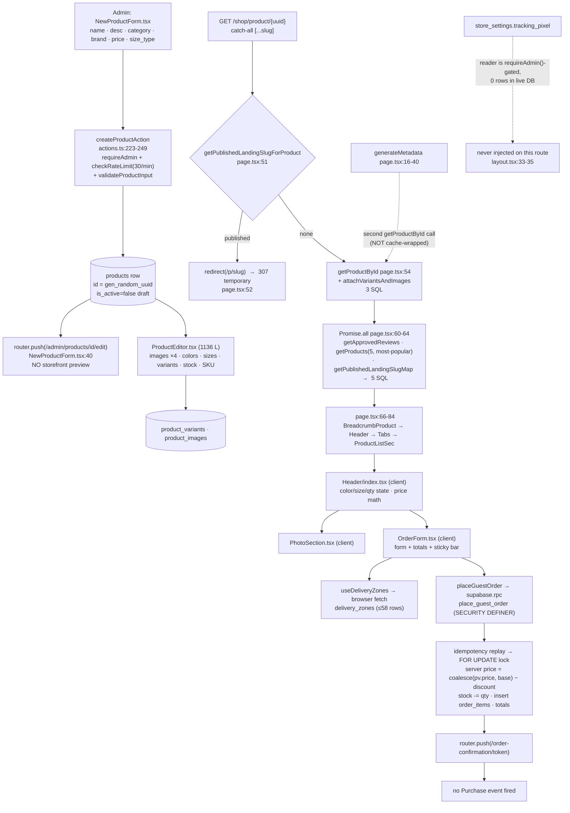

# Deep Audit + Design Spec — Auto-Generated Catalog Product Page (`/shop/product/[...slug]`)

**Scope:** the catalog product page created automatically with every product — `src/app/shop/product/[...slug]/page.tsx` + `src/components/product-page/**` — plus a full **Quantity Bundle Offers** design specification (Phase 3).
**Out of scope:** the landing-page builder `/p/[slug]` (referenced only where it redirects or duplicates this page).
**Mode:** ANALYSIS ONLY. No project file was created, modified or deleted except this report.
**Database evidence:** live project `khaled-ecommerce` (`fvvretvbeiovjozpqbyk`, Postgres 17.11, eu-west-1) via MCP `supabase-khaled`, read-only queries only.
**Date:** 2026-10-26.

---

## 1. Executive Summary

### 1.1 Scores (0–10, mobile customer first, then developer)

| Dim | Dimension | Score | One-line verdict |
|----|-----------|------:|------------------|
| A | Visual design & UI | **4/10** | Desktop-shaped two-column layout forced onto a phone; price falls below the fold; 0-image product breaks the gallery. |
| B | Conversion (CRO) | **3/10** | Sticky bar shows `—` until a wilaya is picked, no trust block, no bundle/quantity offers, no stock urgency. |
| C | Business logic | **6/10** | Server-side pricing, atomic stock locking and idempotency are genuinely good; non-UUID URL → 500, 307 redirect + sitemap conflict. |
| D | Responsive & RTL | **5/10** | Safe-area and keyboard handling are correct; 24 px touch targets and missing overflow guards fail a real thumb test. |
| E | Performance & CWV | **4/10** | Fully dynamic (cookies) route, ~12 SQL round-trips, product fetched twice, LCP image has no `sizes`. |
| F | SEO & sharing | **3/10** | Zero JSON-LD, no Twitter card, canonical can point at `http://localhost:3000`, sitemap lists redirecting URLs. |
| G | Accessibility | **4/10** | No ARIA tabs/radiogroup patterns, unlabeled steppers, sub-4.5:1 grays, no `aria-describedby` on errors. |
| H | Security & integrity | **6/10** | Price tampering impossible, RLS correct, XSS-safe rendering — but zero rate limiting / bot protection on orders and reviews. |
| I | Analytics | **2/10** | Literally no pixel fires on this route; no ViewContent/InitiateCheckout/Purchase; no `content_ids`, no UTM, no consent. |
| J | Code quality | **4/10** | ~62 % of the order form is copy-pasted from the landing section; no component/route tests; index gaps. |
| K | Merchant experience | **4/10** | No preview link, no product SEO fields, no completeness checklist; a live product with 0 images and 0 variants sits in production. |
| — | **Overall** | **≈4.2/10** | Solid transactional core, pre-professional presentation and instrumentation. |

### 1.2 Top 5 critical problems

1. **Zero analytics on the page that receives the ad spend** — no pixel, no `ViewContent`, no `InitiateCheckout`, no `Purchase`. `src/app/layout.tsx:33-35` is literally a `TODO(tracking)` comment; the only pixel injector in the repo is rendered from `src/app/p/[slug]/page.tsx:82`. You cannot optimize or attribute anything.
2. **No quantity bundle offers anywhere** — no table, no admin UI, no customer selector. This is the owner's #2 business priority and it does not exist (`grep offer|bundle|tier` across `src/app/admin` and `supabase/` → 0 product-pricing hits). Meanwhile the sticky mobile bar shows `الإجمالي —` until the customer picks a wilaya (`OrderForm.tsx:474-479`), so the highest-value pixel on the screen shows no price.
3. **SEO foundation is broken or missing** — no JSON-LD of any kind (0 matches repo-wide for `ld+json`/`schema.org`), no `twitter:*`, and `NEXT_PUBLIC_SITE_URL` is absent from `.env.local`/`.env.local.example`, so every canonical URL, `sitemap.xml` and `robots.txt` currently resolve to `http://localhost:3000` / `https://example.com` (`page.tsx:14`, `layout.tsx:9`, `sitemap.ts:5`, `robots.ts:4`).
4. **Customer-facing copy is placeholder, product-agnostic and shirt-specific** — the FAQ tab renders 6 merchant *instructions* ("حدّد نوع القماش…", "اشرح طرق الغسيل…") as if they were answers, on every product including a 2800 DA high-heel listing (`i18n-ar.ts:171-205`, rendered `FaqContent.tsx:16-24`).
5. **No rate limiting or bot protection on the money path** — `place_guest_order` and `submit_review` are called directly from the browser via `supabase.rpc()` (`api/orders.ts:47`, `api/reviews.ts`), bypassing the only rate limiter in the codebase, which guards admin actions exclusively (`src/lib/rate-limit.ts:5` explicitly says an edge layer is still needed).

---

## 2. System Map

### 2.1 Request flow (Mermaid)



### 2.2 Relevant files

| File | Role | Size |
|---|---|---|
| `src/app/shop/product/[...slug]/page.tsx` | Route: metadata, redirect, data fetching, composition | 85 L |
| `src/components/product-page/Header/index.tsx` | Gallery+title+price+options+qty+form orchestration (client) | 299 L |
| `src/components/product-page/Header/PhotoSection.tsx` | Main image + thumbnails (client) | 60 L |
| `src/components/product-page/OrderForm.tsx` | COD checkout, totals, mobile sticky bar (client) | 485 L |
| `src/components/product-page/Tabs/{index,ProductDetailsContent,ReviewsContent,FaqContent}.tsx` | Tab shell + details/reviews/FAQ | 56+37+221+30 L |
| `src/components/product-page/BreadcrumbProduct.tsx` | Breadcrumb (server) | 37 L |
| `src/components/common/{ProductCard,ProductListSec}.tsx` | Related-products rail | 93 / 55 L |
| `src/components/layout/StorefrontChrome.tsx` | Navbar+footer wrapper; strips chrome on `/p/*` | 22 L |
| `src/lib/api/products.ts` | `getProductById` / `getProducts` / `getApprovedReviews` | 259 L |
| `src/lib/api/orders.ts` | `placeGuestOrder` RPC wrapper + Arabic error mapping | 91 L |
| `src/lib/{pricing,quantity}.ts`, `src/lib/checkout/validation.ts` | Client money/qty/validation rules | — |
| `src/lib/store/i18n-ar.ts:126-241` | **All** customer-facing copy for this page | — |
| `src/app/sitemap.ts`, `src/app/robots.ts`, `src/app/layout.tsx` | SEO/tracking wiring | — |
| `supabase/migrations/0001..0014` | Schema, RPCs, triggers, RLS | 14 files |

### 2.3 Live-DB findings (MCP `supabase-khaled`, read-only)

**Migrations / drift**
- Live `supabase_migrations.schema_migrations` = 14 entries, local `supabase/migrations/` = 14 files, names align (`0001_initial_schema … 0014_template_fields`; two entries are stored as `landing_pages` / `guest_note` without the numeric prefix — cosmetic, same files). **No unapplied migrations, no missing migrations → no drift detected.**
- Live constraints verified equal to migrations: `products_discount_mutually_exclusive CHECK (discount_percentage = 0 OR discount_amount = 0)`, `products_rating_check 0..5`, `product_variants_stock_quantity_check >= 0`, `orders_payment_method_cod`, `orders_wilaya_code_range 1..58`, `uq_orders_idempotency_key` (partial unique), `uq_variants_product_color_size`, `uq_images_one_primary` (partial unique), `uq_landing_template_name`.
- **9 public functions**, all `SECURITY DEFINER` except `recalculate_product_rating`, `set_updated_at`, `touch_order_status_updated_at`:
  `place_guest_order`, `submit_review`, `get_order_by_token`, `restore_stock_on_cancel`, `log_order_status_change`, `is_admin`, `recalculate_product_rating`, `set_updated_at`, `touch_order_status_updated_at`.

**RLS (live `pg_policies`)**

| Table | Policy | Command | Condition |
|---|---|---|---|
| `products` | `products_public_read_active` | SELECT | `is_active = true` |
| `product_variants` | `product_variants_public_read_active` | SELECT | `is_active = true AND parent product is_active` |
| `product_images` | `product_images_public_read` | SELECT | parent product `is_active` |
| `reviews` | `reviews_public_read_approved` | SELECT | `is_approved = true` |
| `delivery_zones` | `delivery_zones_public_read` | SELECT | `is_active = true` |
| `product_landing_pages` | `landing pages published read` | SELECT | `status = 'published'` |
| `orders`, `order_items`, `order_status_history`, `store_settings`, `admin_users`, `landing_page_templates` | **none** (RLS enabled, 0 policies) | — | deny-all for `anon`/`authenticated`; written only via SECURITY DEFINER RPCs / service role |

**Advisors**
- **Security advisor** (`get_advisors security`): `RLS Enabled No Policy` ×6 (INFO — expected, see above); `anon_security_definer_function_executable` ×3 → `place_guest_order`, `submit_review`, `get_order_by_token` callable by anon (WARN — intended for COD, but this *is* the abuse surface); `authenticated_security_definer_function_executable` ×4; `Leaked Password Protection Disabled` (WARN, auth setting).
- **Performance advisor**: one `Unused Index` → `idx_orders_status_created` on `public.orders` (INFO).

**Data quality (live counts, 11 products / 44 variants / 24 images / 3 reviews / 4 orders)**

| Metric | Value |
|---|---|
| products total / active | 11 / 11 |
| products with **no image** | **1** (`sobat`, `f700a39f…`, 1500 DA) |
| products with **no variants** | **1** (same product → renders as permanently out of stock) |
| products with **no description** | 0 — but descriptions are **8–54 chars** (max 54, min 8) → meta description ~8 chars for `sobat` |
| products with no category / no brand | 3 / 3 (specs table renders `-`) |
| products with a discount | 6 (3 × percentage, 2 × amount, 1 combined 15 % …); 5 with none |
| products with `rating > 0` | **2 of 11** → 9 pages render an empty `0.0/5` star row |
| variants with zero stock | 2 |
| variants with a custom `price` | **0** (variant pricing path is unexercised) |
| images missing `alt_text` | 6 of 24 |
| approved reviews | 3 of 3 |
| `store_settings` rows | **0** (tracking pixel defaults to `enabled:false, pixel_id:""`); `store_settings` has no RLS policy |
| delivery zones | 58 rows, all with `is_active` |
| product landing pages | 3 (→ 3 products redirect away from this page) |

**`place_guest_order` (live source, read via MCP)** — key behaviours the bundle feature must integrate with:
- idempotency: replay by `p_idempotency_key` returns the existing order; unique-violation race handled by re-select.
- phone: `^\+?[0-9]{6,15}$` after stripping separators (server accepts **6-digit** numbers; no Algerian `05/06` rule).
- limits: ≤ 50 distinct items, **1–10 units per variant (summed across items)**, ≤ 100 units per order.
- locking: `SELECT … ORDER BY id FOR UPDATE` over all requested variants up-front, then per-row `FOR UPDATE OF pv`.
- pricing: `effective_price = coalesce(pv.price, p.base_price)`; `unit_discount = pct? round(effective*pct/100,2) : amount`, capped at `effective`; `unit_price = effective − discount`; `subtotal = Σ effective×qty`, `total = subtotal − discount_total + delivery_price`.
- stock: raises `Insufficient stock` when `stock_quantity < qty`, then decrements.
- delivery: price read server-side from `delivery_zones` by `wilaya_code` + `delivery_type`.
- **No rate limit, no bot check, no offer/bundle concept.**

### 2.4 Product fields that feed the page vs. fields a professional page needs

**Feeding the page today** (select list `api/products.ts:218`, plus relations):

| Field | Source | Used at |
|---|---|---|
| `id` | `products` | URL, canonical, related filter, JSON-LD (unused) |
| `name` | `products` | `<h1>`, title, alt text, OG title |
| `description` | `products` | meta description (≤160 graphemes), body ×2 |
| `category`, `brand` | `products` | specs table only (often `-`) |
| `base_price` | `products` | price, strikethrough, tier math (future) |
| `discount_percentage` / `discount_amount` | `products` | price + discount pill (mutually exclusive by CHECK) |
| `rating` | `products` (trigger-maintained) | stars + `x/5` text |
| `is_active` | `products` | visibility filter |
| `size_type` | `products` | size sorting |
| `created_at` | `products` | not rendered |
| `variants[] {id,color,color_hex,size,price,stock_quantity,is_active,sku}` | `product_variants` | option pickers, stock, unit price |
| `images[] {id,url,alt_text,position,is_primary,color}` | `product_images` | gallery, OG image |
| `reviews[]` | `reviews` | reviews tab |
| delivery zones | `delivery_zones` (browser) | wilaya/fees |
| landing slug | `product_landing_pages` | redirect + related-card hrefs |

**MISSING for a professional page (none exist as columns):**

| Missing capability | Impact today |
|---|---|
| **quantity bundle offers (1/2/3 tiers)** | feature absent — Phase 3 spec below |
| `compare_at_price` (explicit old price) | price anchoring relies on `base_price − discount` only |
| SEO: `slug`, `seo_title`, `seo_description`, `og_image`, `canonical` | UUID URLs, no editable metadata (landing pages *do* have these, `0011_landing_pages.sql:56-60`) |
| benefits bullets, specifications/attributes | specs = category+brand only |
| per-product FAQ | hardcoded generic FAQ |
| video / media | none |
| badges (stock, delivery ETA, guarantee, best-seller) | none |
| delivery ETA / free-shipping threshold | none |
| review aggregates (count, histogram) | only average `rating` |
| `sold_count` / `low_stock_threshold` | no urgency signal |
| related/upsell relations | "related" = global top-5 by rating |
| `gtin`/`mpn`/`material`/`weight` | no rich results |

### 2.5 Templated / hardcoded copy inventory (with judgement)

| Copy | Source | Rendered at | Judgement |
|---|---|---|---|
| FAQ ×6: "ما هي خامة القميص؟" → "حدّد نوع القماش (مثل القطن…)" etc. | `i18n-ar.ts:171-204` | `FaqContent.tsx:16-24` | **Fake + misleading**: these are *instructions to the merchant*, shirt-specific, identical on all 11 products (incl. shoes at 2800 DA). Reads as lorem-ipsum. |
| "تفاصيل المنتج" + category/brand rows | `i18n-ar.ts:139-143` | `ProductDetailsContent.tsx:6-9` | **Generic + thin**: 2 rows, `-` for 3/11 products. |
| Product description, twice verbatim | `Header/index.tsx:185-187` and `ProductDetailsContent.tsx:16` | body + details tab | **Duplicated**. |
| Tabs: "تفاصيل المنتج / التقييم والمراجعات / الأسئلة الشائعة" | `i18n-ar.ts:144-148` | `Tabs/index.tsx:18-22` | OK wording; reviews/FAQ hidden behind non-default tabs. |
| "لا توجد تقييمات بعد. كن أول من يترك تقييمًا." | `i18n-ar.ts:152` | `ReviewsContent.tsx:52` | Honest, good. |
| "الدفع عند الاستلام. يُعاد احتساب الإجمالي النهائي على الخادم." | `i18n-ar.ts:225` | `OrderForm.tsx:441` | Accurate (verified in RPC) but 11 px gray — buried. |
| Phone placeholder `+213 5XX XX XX XX` + "8 أرقام على الأقل" | `i18n-ar.ts:211,232` | `OrderForm.tsx:311`, `validation.ts:17` | **Misleading**: does not enforce the shown `05/06` format; server accepts 6 digits. |
| "المتبقي {n} قطعة" / "{name} — نفدت الكمية" | `i18n-ar.ts:135-136` | **only** `landing/…/OrderFormSection.tsx:449,496,547` | Dead copy on the catalog page — no stock urgency here. |
| "قد يعجبك أيضًا" related rail | `i18n-ar.ts:138` | `ProductListSec` | Heading honest, content **not related** (`page.tsx:62`). |
| `0.0/5` + empty stars | computed | `Header/index.tsx:151-161` | **Negative signal** on 9/11 products. |
| No urgency/fake countdown found | — | — | ✅ no fake urgency anywhere — do not add any. |

### 2.6 Quantity, price, discount — end-to-end today

1. **Admin**: `validateProductInput` enforces `0 ≤ pct ≤ 100`, `amount ≥ 0`, `pct = 0 XOR amount = 0`, `amount ≤ base_price` (`admin/product-validation.ts:62-79`), mirrored by DB CHECK.
2. **Server fetch**: raw `base_price`, `discount_percentage`, `discount_amount`, `variants[].price` (`api/products.ts:218` + `attachVariantsAndImages`).
3. **Client display** (`Header/index.tsx:112-125`): `basePrice = getEffectivePrice(base_price, variant.price)` → `price = getDiscountedPrice(...)`; both use `round2` to mirror SQL `round(...,2)` (`lib/pricing.ts:24-30`). Strikethrough shows `basePrice`; pill shows `-pct%` or `-amount DA`.
4. **Client order totals** (`OrderForm.tsx:112-115`): `subtotal = round2(unitPrice×qty)` **pre-discount**, `discountTotal = round2(unitDiscount×qty)`, `deliveryPrice` from selected zone, `orderTotal = subtotal − discount + delivery`.
5. **Quantity**: free stepper in `Header/index.tsx:254-274`, clamped `1 … min(10, stock)`; `MAX_QUANTITY_PER_VARIANT = 10` (`lib/quantity.ts:3`).
6. **Submission** (`OrderForm.tsx:195-203`): only `{variant_id, quantity}` is sent — **no price** travels from the client.
7. **RPC recomputes** everything (see §2.3): price, discount, delivery, totals; writes `unit_price_at_purchase` (net) and `discount_amount_at_purchase` per line; decrements stock; returns authoritative totals.
8. **Post-order**: redirect to `/order-confirmation/{token}` — no pixel, no Purchase event.

**Conclusion:** the money path is trustworthy end-to-end. The gap is that *nothing above the order form communicates price dynamically*, and there is no tier concept at any layer.

---

## 3. Findings Table

Severity: **C**ritical / **H**igh / **M**edium / **L**ow. Effort: S (<1 day) / M (≤1 week) / L (>1 week).

| ID | Dim | Sev | Problem | Evidence | Impact | Recommended fix | Effort |
|----|-----|-----|---------|----------|--------|-----------------|--------|
| PP-001 | A | H | On a 390×844 viewport the price/rating are **below the fold**: breadcrumb → full-width image (min-h 330 px) → `<h1>` → stars → price | `page.tsx:70-73`; `Header/index.tsx:132` (`grid-cols-1` mobile); `PhotoSection.tsx:46` (`min-h-[330px]`) | Paid click sees a photo and a title, no price → bounce | Mobile layout: compact 60–70 vh image (or 4:5), title+price+rating block directly under it, or overlay price chip | M |
| PP-002 | A | C | **Product with 0 images renders `<Image src="">`** — gallery breaks / errors | Live: `sobat` `img_count=0` (MCP); `Header/index.tsx:67-68` → `""`; `PhotoSection.tsx:47-54` unguarded `src={selected}` | Broken hero or full error page on a real product (1/11 today) | Empty-state placeholder (`/images/pic1.png` like `ProductCard.tsx:21`) + skip thumbnails | S |
| PP-003 | A | M | Gallery has no swipe carousel, no dots/counter, no pinch-zoom, no lightbox; thumbnails sit *below* the image on mobile | `PhotoSection.tsx:24-44` (`flex-col-reverse`, click-only) | Customers can't inspect product → cart loss, esp. fashion | Embla/Swiper carousel + tap-to-zoom lightbox, `aspect` preserved | M |
| PP-004 | A | M | 9 of 11 products render an **empty star row with `0.0/5`** | MCP: `rating=0.00` ×9; `Header/index.tsx:151-161` | Looks broken/untrusted | Hide rating block when `rating === 0` (show "لا تقييمات بعد" or nothing) | S |
| PP-005 | A | M | Empty/degraded states: description is 8–54 chars (fits 1 line), specs show `-`, no images, no reviews (default tab hides them) | MCP `desc_len` 8…54; `ProductDetailsContent.tsx:7-8`; `Tabs/index.tsx:25` | Page looks unfinished | Hide empty spec rows; show rich description with paragraphs; surface review count next to rating | M |
| PP-006 | A | M | Mobile order: gallery first, then all copy — long descriptions push options/CTA far down | `Header/index.tsx:132-293` single column | High scroll depth before the order form | Split: sticky "buy card" (price+CTA) that appears on scroll; move description below the form | M |
| PP-007 | A | M | Description rendered twice verbatim | `Header/index.tsx:185-187` + `ProductDetailsContent.tsx:16` | Redundant, hurts perceived quality | Show teaser (2 lines + "المزيد") up top, full text only in details tab | S |
| PP-008 | A | L | `hover:scale-110` on gallery images has no hover on touch; `hover` states waste CSS on mobile | `PhotoSection.tsx:38,51` | Cosmetic only | Keep, but add `:active` feedback for touch | S |
| PP-009 | B | C | **Sticky mobile bar shows `الإجمالي —`** until a wilaya is selected, and never shows the product/offer price | `OrderForm.tsx:474-479` (`selectedZone ? … : "—"`) | Highest-visibility element shows no number → weaker purchase intent | Show `الإجمالي` = subtotal (+ delivery "تُحسب عند اختيار الولاية"); after tier selection show tier total + "وفّر X" | S |
| PP-010 | B | C | **No quantity/bundle offers anywhere** (owner priority #2) | `grep offer\|bundle\|tier` in `src/app/admin` → only delivery bulk prices `actions.ts:673`; `supabase/` → 0 tables | No AOV lever, no "2 = cheaper" hook that COD stores live on | Phase 3 spec (§6) | L |
| PP-011 | B | H | **No trust signals**: no COD badge, delivery-time promise, returns/guarantee, phone/WhatsApp, secure-checkout line; the only reassurance is 11 px gray `codNote` | `OrderForm.tsx:441`; no such component under `product-page/` | COD buyers bounce on "will it arrive / can I return it" | Add a compact trust strip above the form (COD · توصيل 58 ولاية · إرجاع 7 أيام) + footer links | M |
| PP-012 | B | H | "Related products" are **not related** — global top-5 by `rating` | `page.tsx:62` `getProducts({pageSize:5, sort:"most-popular"})` → `products.ts:196-199` orders by `rating desc` | Cross-sell misses intent; also the current product can occupy a slot until filtered after fetch (`page.tsx:79`) | Same-category/brand query (exclude self server-side), then best-sellers | M |
| PP-013 | B | H | Reviews (3 approved in DB) are behind a **non-default tab**; count not shown near the rating | `Tabs/index.tsx:25` default `1`; `Header/index.tsx:150-162` | Social proof invisible on load | Show rating + `(3 تقييمات)` linking to reviews; move reviews above FAQ | S |
| PP-014 | B | M | No stock/urgency signal on catalog (string exists, used only by landing) | `i18n-ar.ts:135` used only in `OrderFormSection.tsx:547` | Missed scarcity lever; also no out-of-stock explanation for `stock=0` variants beyond line-through | Show `المتبقي {n}` when `stock ≤ 5`, per-size "نفدت الكمية" chip | S |
| PP-015 | B | M | Delivery radio shows `—` and totals box shows `—` before wilaya → the customer can't see any total | `OrderForm.tsx:384,434,439` | Perceived price opacity | Show subtotal always; mark delivery "يُحتسب حسب الولاية" | S |
| PP-016 | B | H | Phone validation accepts any ≥8 digits; placeholder promises `+213 5XX` format; server accepts 6–15 digits | `checkout/validation.ts:13-18`; `i18n-ar.ts:211,232`; RPC `^\+?[0-9]{6,15}$` | Undeliverable orders, failed COD confirmation calls | Client+server enforce `^(05\|06)\d{8}$` (or `+213` equivalent); keep lenient legacy path flagged | M |
| PP-017 | B | M | No free-shipping threshold, no bundle hint, no "buy 2 save" nudge anywhere | `OrderForm.tsx` (no such logic) | Flat AOV | Bundle tiers (Phase 3) + delivery-fee messaging | M |
| PP-018 | B | L | Related rail can render an empty carousel with just a heading | `page.tsx:79` filter can drop all 5 | Odd empty section | Render section only if `related.length > 0` | S |
| PP-019 | C | H | **Non-UUID path → HTTP 500 instead of 404** | `page.tsx:54` `getProductById` without `.catch`; `api/products.ts:224` `throw new Error(error.message)` | Bad URL = server error page, hurts SEO/monitoring | Wrap in `.catch(() => null)` → `notFound()` (metadata already does this, `page.tsx:21`) | S |
| PP-020 | C | M | `[...slug]` catch-all accepts extra segments: `/shop/product/{uuid}/anything` renders 200 | `page.tsx:21,47` uses `slug[0]` only | Crawlable duplicate URLs (canonical mitigates) | Use `[slug]` single segment or `notFound()` when `slug.length > 1` | S |
| PP-021 | C | M | Landing redirect is **307 temporary** while the sitemap still advertises that URL, and `generateMetadata` still computes a canonical for the redirecting request | `page.tsx:51-52` (`redirect()` = 307); `sitemap.ts:37` | Google may keep re-crawling a redirect; canonical mismatch | Emit `/p/{slug}` in sitemap (and exclude redirecting product URLs); consider 308 once behaviour is settled | S |
| PP-022 | C | M | Inactive/draft product → generic global 404 with no product context; no dedicated `not-found.tsx` on this route | `page.tsx:56-58`; no `product/[...slug]/not-found.tsx` (landing has one, `p/[slug]/not-found.tsx`) | Weak recovery path | Add route `not-found.tsx` with "منتجات أخرى" CTA | S |
| PP-023 | C | L | `quantity` state never re-syncs when the selected variant/stock changes | `Header/index.tsx:128` `useState(1)`; no effect | Can show a quantity > stock → button reads "نفدت الكمية" misleadingly | `useEffect` clamp to `min(q, max(1, stock))` | S |
| PP-024 | C | L | Product list sort "الأكثر مبيعاً" actually sorts by `rating` (max 5 distinct values, 2/11 non-zero) | `products.ts:196-199` | Meaningless ordering, unstable | Order by `sold_count`/`orders` metric or `created_at` | M |
| PP-025 | C | **+** | ✅ **Strength:** server-side price recomputation, stock `FOR UPDATE`, idempotency, delivery price from DB — client never decides money | RPC source (MCP); `OrderForm.tsx:195-203` sends no price | Price tampering impossible | Do not touch; extend carefully (§6) | — |
| PP-026 | D | H | Touch targets below 44 px: quantity `−/+` buttons **24×24** (`h-6 w-6`), colour swatches **36×36** (`w-9 h-9`) | `Header/index.tsx:201,258,266` | Mis-taps on mobile (WCAG 2.5.5 AAA / platform HIG 44 pt) | Stepper ≥40 px hit area (padding), swatches `w-11 h-11` | S |
| PP-027 | D | M | Tab buttons use `p-5` + `flex-1` with 3 long Arabic labels in `overflow-x-auto` | `Tabs/index.tsx:29-45` | Text wraps/truncates on 360 px | Compact tabs (13–14 px, single line, `whitespace-nowrap`) with scroll indicator | S |
| PP-028 | D | M | Sticky bar spacer is only `h-2`; last field can be obscured when the keyboard is closed but the bar is up | `OrderForm.tsx:461-463` | Last field partly hidden | Reserve `pb-[calc(bar height + safe-area)]` on the form container | S |
| PP-029 | D | **+** | ✅ **Strength:** `env(safe-area-inset-bottom)` on the sticky bar **and** `visualViewport` keyboard offset handling | `OrderForm.tsx:81-100,467-471` | iOS keyboard/CCTV bar handled correctly | Keep | — |
| PP-030 | D | M | No `overflow-x-hidden` guard; long unbroken product names are not truncated in `<h1>` or cards | no matches in `src/styles/*`; `ProductCard.tsx:53` no `line-clamp` | Horizontal scroll / layout break with long Arabic or Latin names | `break-words` on h1, `line-clamp-2` on cards, global `overflow-x:hidden` on `body` (careful with sticky) | S |
| PP-031 | D | L | Numbers use `<bdi dir="ltr">` (price, rating, discount) — correct | `Price.tsx:13`, `Header/index.tsx:160,176,181` | ✅ bidi-safe | Keep | — |
| PP-032 | D | L | `dir="rtl"` on `<html>` + logical properties (`ms-`, `me-`, `ps-`) used consistently | `layout.tsx:31`; `Header/index.tsx:159,223` | ✅ correct RTL | Keep | — |
| PP-033 | E | H | Route is **fully dynamic**: every data call uses `createServerSupabase()` → `cookies()`; no `revalidate`, no `dynamic`, no `Cache-Control` | `supabase/server.ts:18`; `page.tsx` (no export); `next.config.mjs:37-60` security headers only | Every hit = full SSR + ~12 queries; LCP/TTFB suffer on 4G | Use an anon, cookie-free client for public reads (landing already does this) + `revalidate = 300` | M |
| PP-034 | E | H | ~**12 SQL round-trips** per request; `getProductById` runs **twice** (metadata + page) and is not `cache()`-wrapped | `page.tsx:21` + `:54`; landing helpers *are* wrapped (`landing/api.ts:52,89,109`) | Wasted latency | `import { cache } from "react"` around `getProductById`; share result with `generateMetadata` | S |
| PP-035 | E | M | `getProducts` uses `{count:"exact"}` even when only 5 rows are needed | `products.ts:155` | Full-table count on every request | `count:"estimated"` or omit for the related rail | S |
| PP-036 | E | H | LCP image has `priority` but **no `sizes`** → srcset resolves as `100vw`, downloading a viewport-width image for a ~390 px card | `PhotoSection.tsx:47-54` | Wasted bytes on the critical image | `sizes="(max-width: 768px) 100vw, 50vw"` (or exact container) | S |
| PP-037 | E | M | 93 % of this route's component code is `"use client"` (1121 of 1225 LOC); `@supabase/supabase-js` is statically imported by the form | `OrderForm.tsx:6` (landing dynamic-imports it, `OrderFormSection.tsx:331`) | Larger hydration bundle | Dynamic-import `placeGuestOrder`; move pure display parts to server components | M |
| PP-038 | E | M | Google fonts: Cairo (3 weights) + Tajawal + Almarai declared in one module | `src/styles/fonts/index.ts` | Extra font downloads if referenced anywhere on the route | Keep only fonts actually used per route | S |
| PP-039 | E | L | `getApprovedReviews` has no `LIMIT` | `products.ts:240` | Unbounded payload for a popular product | `.limit(20)` (tab shows a "show all" path) | S |
| PP-040 | E | M | Delivery zones are fetched **from the browser** on mount; CTA stays blocked until it resolves | `useDeliveryZones.ts:20-38`; `OrderForm.tsx:126,170` | Extra round-trip + waterfall before checkout is usable | Server-render zones (they're public, ≤58 rows) | M |
| PP-041 | F | C | **No JSON-LD anywhere** — no `Product`, `Offer`, `AggregateOffer`, `AggregateRating`, `BreadcrumbList`, `FAQPage` | repo grep `ld+json\|schema.org` → 0 code hits | No rich results, no price/stock in SERP, weak CTR | Add Product+Offer(+AggregateRating) script (§6.5) | M |
| PP-042 | F | C | `NEXT_PUBLIC_SITE_URL` missing from `.env.local` and `.env.local.example` → canonical/OG/sitemap/robots fall back to `http://localhost:3000` / `https://example.com` | `page.tsx:14`, `layout.tsx:9`, `sitemap.ts:5`, `robots.ts:4` | Every canonical points at localhost → de-indexing risk | Set env in prod + document in `.env.local.example`; fail fast if unset | S |
| PP-043 | F | H | Metadata gaps: no `title.template` (no brand suffix), description from 8–54 char descriptions, OG image without `width/height/alt`, `og:type = website` not `product`, **no `twitter:*` at all** | `page.tsx:27-39`; `layout.tsx:11-19`; repo grep `twitter` → 0 | Poor social/ads previews | Add template, fallback description, `openGraph.type="product"`, `twitter.card="summary_large_image"` | S |
| PP-044 | F | H | Sitemap: lists `/shop/product/{id}` **including redirecting ones**, omits `/p/{slug}`, hard cap `pageSize:100`, `lastModified = new Date()` every crawl, origin fallback `https://example.com` | `sitemap.ts:5,26,37-40` | Crawl budget wasted, no freshness signal | Emit `/p/*` for published landing pages, drop redirecting URLs, use real `updated_at` | S |
| PP-045 | F | M | Two `<h1>` (product name + footer brand); tab panels jump `h1 → h3`; the only `h2` renders after them | `Header/index.tsx:142`; `Footer/index.tsx:18`; `Tabs/*Content.tsx:13,31,13`; `ProductListSec.tsx:32` | Diluted semantics for crawlers/screen readers | Footer brand → `p`/`div`; tabs → `h2`; panel titles → `h3` | S |
| PP-046 | F | M | Alt text: identical product-name alt on main image *and* every thumbnail; decorative hover image repeats it | `PhotoSection.tsx:39,52`; `ProductCard.tsx:41,49` | Ambiguous image semantics | `"${name} — صورة 1/3"`; `alt=""` for the hover duplicate | S |
| PP-047 | F | M | Breadcrumb: good semantics but no JSON-LD and no category level despite `product.category` existing | `BreadcrumbProduct.tsx:15-33` | Lost breadcrumb rich result | Add `BreadcrumbList` JSON-LD + category crumb | S |
| PP-048 | F | M | URL is a raw UUID (`/shop/product/ccdde0c3-…`), no `slug` column on `products` | `page.tsx:26`; schema (no slug) | Unreadable, unshareable, no keywords in URL | Add `slug` (unique, slugified name) with 301 from the UUID form | M |
| PP-049 | F | L | `robots.ts` allows `/shop/product` and `/p/*`, disallows only `/admin/`, `/api/` | `robots.ts:7-11` | ✅ correct | Keep | — |
| PP-050 | G | H | Option selectors are plain `<button>`s with **no `radiogroup`/`aria-checked`/`aria-pressed`**, selected state is colour-only | `Header/index.tsx:196-247` | Screen readers can't perceive selection (WCAG 1.3.1, 4.1.2) | `role="radiogroup"` + `role="radio"`/`aria-checked`, or real `<input type=radio>` + labels | M |
| PP-051 | G | H | Tabs don't follow the ARIA tabs pattern: no `role="tablist"/"tab"/"tabpanel"`, no `aria-selected`, no arrow-key navigation, content not associated | `Tabs/index.tsx:29-51` | Keyboard users can't operate tabs (WCAG 2.1.1, 4.1.2) | Radix `Tabs` (already a dependency for Accordion/Dialog) | M |
| PP-052 | G | M | Quantity `−/+` buttons have no `aria-label` (accessible name is the glyph), 24 px target | `Header/index.tsx:256-272` | Unusable via SR/switch control | `aria-label="إنقاص الكمية"` / `"...زيادة"`, `aria-live` on the value | S |
| PP-053 | G | M | Field errors are plain `<p>` without `aria-invalid` / `aria-describedby` / `role="alert"` | `OrderForm.tsx:294-295,319,350,413` | Errors not announced (WCAG 3.3.1) | Wire ids + `aria-describedby`; `aria-live="polite"` on the error box | S |
| PP-054 | G | M | Contrast failures: `text-black/50` (~4.0:1 on white at 11 px) and `text-black/40` strikethrough (~2.6:1) | `OrderForm.tsx:474,391,441`; `Header/index.tsx:171` | WCAG 1.4.3 fail for small text | Use ≥ `text-black/60` on white at ≥14 px, or a gray token ≥ #767676 | S |
| PP-055 | G | L | Review form: labels present, star buttons have `aria-label`s, honeypot is `aria-hidden` | `ReviewsContent.tsx:134-199` | ✅ good | Keep | — |
| PP-056 | G | L | No visible focus reset on custom buttons (Radix primitives supply it; raw `<button>`s in `Header` rely on UA outline, which is acceptable) | `Header/index.tsx:197,233` | Acceptable default | Verify with keyboard pass; add `focus-visible:ring` for consistency | S |
| PP-057 | H | H | **No rate limiting / bot protection on `place_guest_order` or `submit_review`** — direct browser→RPC; only admin actions are limited | `api/orders.ts:47`; `rate-limit.ts:5` comment; `checkRateLimit` used only in `admin/actions.ts:12,236` | Order spam, review spam, DB growth, wasted confirmations | Edge rate limit (Cloudflare/Turnstile) or a Supabase Edge Function proxy; per-IP + per-phone daily caps | L |
| PP-058 | H | M | `submit_review` has no dedup/throttle (same name+product can be posted repeatedly) and inserts unbounded rows | RPC source (MCP): validates length/rating only | Table growth, moderation load | Unique (product_id, normalized name) or cooldown; keep `is_approved=false` default | M |
| PP-059 | H | M | Honeypot is client-side only and bypassable | `OrderForm.tsx:444-457` | Low-value bot filter | Keep, but don't rely on it (see PP-057) | S |
| PP-060 | H | **+** | ✅ **Strength:** RLS verified — public tables expose only `is_active`/approved rows; `orders`/`order_items` are deny-all for anon and reachable only through SECURITY DEFINER RPCs | live `pg_policies` (§2.3) | No direct data tampering | Keep | — |
| PP-061 | H | **+** | ✅ **Strength:** XSS-safe rendering — description and review text are rendered as React text nodes; no `dangerouslySetInnerHTML` on this route | `Header/index.tsx:186`, `ReviewCard`, repo grep | No stored XSS vector | Keep | — |
| PP-062 | H | M | Security advisor WARN: 3 anon-callable `SECURITY DEFINER` functions + leaked-password protection disabled | MCP `get_advisors security` | Documented exposure; weak admin auth hygiene | Enable leaked-password check; keep RPCs public but rate-limit them | S |
| PP-063 | H | L | `get_order_by_token` is anon-callable with a UUID token (122-bit) — acceptable, but no throttling | RPC source; advisor WARN | Theoretical brute force (negligible) | Add rate limit at edge with PP-057 | S |
| PP-064 | H | **+** | ✅ **Strength:** internal fields not exposed — select lists are explicit whitelists | `products.ts:218`, `:236` | No column over-exposure | Keep | — |
| PP-065 | I | C | **Zero pixels on this route** — no `PageView`, no `ViewContent` | `layout.tsx:33-35` TODO; grep `fbq\|ttq\|gtag` in `product-page/**` → 0 | No attribution, no optimization, no retargeting audiences | Inject store pixel server-side in root layout; fire `ViewContent` on product mount | M |
| PP-066 | I | C | Catalog checkout fires **no** `InitiateCheckout` / `Purchase` (landing does) | `OrderForm.tsx:156-211` (no tracking calls); `order-confirmation` page also silent | Conversion funnels show 0 catalog revenue | Fire `InitiateCheckout` on submit and `Purchase` with `placed.total` + `event_id` after RPC | M |
| PP-067 | I | H | Store-wide pixel setting is read through `requireAdmin()` and **never injected**; live `store_settings` has 0 rows → `enabled:false` | `api/store-settings.ts:33-49`; `settings/page.tsx:9`; MCP row count | Admin can configure a pixel that can never fire | Add a public, anon-safe reader (service role in a route handler / RLS policy) and inject | M |
| PP-068 | I | H | No `content_ids`, `content_name`, `content_type`, `contents`, `event_id`, no UTM capture, no consent banner, no GA/GTM | `tracking.ts:35-42` (only `currency/value/quantity`); repo grep `utm_\|consent\|event_id` → 0 | Can't optimize catalog ads or dedup browser/server events | Extend the tracker payload; store UTM in first-party cookie; add consent if you target EU/UK traffic | M |
| PP-069 | I | **+** | ✅ **Strength:** CSP already whitelists Facebook + TikTok origins, so injection is the only blocker | `next.config.mjs:16,18,20` | — | Keep | — |
| PP-070 | J | H | `product-page/OrderForm.tsx` vs `landing/sections/OrderFormSection.tsx` share ~300 LOC (62 % of the catalog form) — refs, zone memo, totals, errors, scroll-to-invalid, honeypot, submit skeleton are literal copies; behaviour has already drifted | `OrderForm.tsx:31-45,102-115,131-154,156-211,444-457` vs `OrderFormSection.tsx:184-208,210-246,263-276,278-360,776-789` | Double maintenance; bundle features must be built twice or drift further | Extract a shared `useCheckoutForm` hook + `<CheckoutFields>`/`<OrderSummary>` components used by both | L |
| PP-071 | J | M | No `loading.tsx` / `error.tsx` / `not-found.tsx` on this route (inherits `/shop`'s generic ones); no product-specific 404 | no files under `src/app/shop/product/[...slug]/`; `p/[slug]/not-found.tsx` exists | Generic error UX | Add route-level boundaries | S |
| PP-072 | J | M | **No tests** for the product page, its components, `api/products.ts`, or the RPC path; 32 test files cover libs only | `vitest.config.ts:11` (`src/**/*.test.ts` only); no `product-page` test files | Regressions land unnoticed (e.g. form drift) | Add pricing/qty parity tests (exist) + component render tests + e2e | M |
| PP-073 | J | M | Index gaps for this page's queries: no `(is_active, rating)` / `products(created_at)`, no `reviews(product_id, is_approved, created_at)`; perf advisor: unused `idx_orders_status_created` | MCP `pg_indexes` + advisor; `products.ts:155,198`, `:240` | Sort/scan cost grows with catalogue | Add the 3 composite indexes; drop or use the unused one (SQL only — §7 roadmap) | S |
| PP-074 | J | L | `let query: any` and unbounded `.or(...)`/`.in(id, ids)` patterns | `products.ts:151,178,183` | Type safety lost; large `IN` lists | Type with PostgREST builder generics; cap filter sets | M |
| PP-075 | J | L | No `React.cache` on any product read (landing helpers have it) | `api/products.ts` | Repeat queries per request | Wrap all three readers | S |
| PP-076 | K | H | After creating a product the merchant lands in the **editor**, never sees the public page; there is no "view product page" link anywhere in admin | `NewProductForm.tsx:40`; `grep href=` under `products/**` → only admin URLs | Merchants ship blind pages | Add "معاينة الصفحة" button → `/shop/product/{id}` (respecting redirect) | S |
| PP-077 | K | H | **No SEO fields for products** — title/description/canonical/OG exist only on landing pages | grep `seo` in `src/app/admin` → landing only; `0011_landing_pages.sql:56-60` | Catalog pages can't be optimized at all | Add `seo_title`/`seo_description`/`og_image` columns + editor fields | M |
| PP-078 | K | H | No completeness checklist; empty description allowed; a product with **0 images and 0 variants is live** in production | `product-validation.ts:50-53`; MCP row `sobat` | Broken public pages shipped unknowingly | Post-create checklist card: images ✓ description ✓ variants ✓ stock ✓ SEO ✓ offers ✓; block `is_active` when critical items missing | M |
| PP-079 | K | M | Merchant is never told that publishing a landing page silently 307-redirects the catalog page away | `page.tsx:49-52`; admin copy `admin/i18n-ar.ts:315-316` | Confusion ("where did my reviews tab go?") | Surface redirect status in the product admin header | S |
| PP-080 | K | M | No per-product FAQ, badges, video, benefits or gallery captions anywhere in the editor | `ProductEditor.tsx` field list (§2.4) | Page stays thin | Add fields incrementally after bundles (roadmap) | L |
| PP-081 | K | L | Production DB holds demo data (`Polo Shirt`, `brand=DEMO`, prices `25.00 DA`, English names) | MCP sample rows | Store looks unprofessional if exposed | Seed/cleanup script (ops, not code) | S |
| PP-082 | B | L | Delivery radios show price `—` before wilaya and reuse a shared `name` group (fine), but there's no "التوصيل مجاني فوق X" lever | `OrderForm.tsx:354-393` | Missed AOV lever | Free-delivery threshold messaging | M |
| PP-083 | A | L | `HolyLoader` progress bar + `framer-motion` `whileInView` animations (0.6 s, `delay: 0.6`) on the related rail | `layout.tsx:36`; `ProductListSec.tsx:32-50` | Motion without `prefers-reduced-motion` guard | Gate animations with reduced-motion (pattern exists: `AnimatedCounter.tsx:35`) | S |
| PP-084 | C | L | `orders` have only 4 rows — no production traffic yet, so all CRO/perf numbers are still projections | MCP row counts | Prioritize measurement before redesign | Ship analytics first (PP-065) | — |
| PP-085 | F | L | No `canonical` conflict between `/shop/product/{id}` and `/p/{slug}` because the redirect returns early — but metadata for the redirecting URL is still computed first | `page.tsx:16-40` before `:51` | Minor wasted work | Short-circuit before `generateMetadata` heavy work | S |

---

## 4. Verified Strengths (do NOT touch)

1. **Money integrity:** client sends only `variant_id + quantity`; the RPC recomputes price, discount (capped at price), delivery fee and totals (`place_guest_order`, MCP source). `unit_price_at_purchase` / `discount_amount_at_purchase` snapshot the truth.
2. **Concurrency:** variants are locked up-front in deterministic `ORDER BY id` order plus per-row `FOR UPDATE OF pv`; stock checked then decremented; idempotency key with unique-violation replay prevents double orders.
3. **RLS verified live:** public read limited to `is_active` products/variants/images, `is_approved` reviews, `is_active` zones; `orders`, `order_items`, `store_settings`, `admin_users` are deny-all for anon.
4. **XSS-safe:** no `dangerouslySetInnerHTML` on this route; descriptions/reviews render as text.
5. **Bidi-correct pricing:** `Price` wraps amounts in `<bdi dir="ltr">`; `round2` mirrors SQL `round(...,2)` and is covered by parity tests (`order-form-money.test.ts`).
6. **Mobile sticky keyboard handling:** `visualViewport` offset + `env(safe-area-inset-bottom)` on the action bar (`OrderForm.tsx:81-100,467-471`) — a real implementation detail many stores miss.
7. **Error mapping:** raw Postgres errors are never shown; regex-mapped Arabic messages (`api/orders.ts:52-81`), incl. honeypot rejection.
8. **Honeypot** on both order and review forms, admin actions rate-limited (30/min).
9. **No fake urgency / fake reviews on this surface** — ratings come from a DB trigger over approved reviews only (`0002:174-209`); testimonials fakery exists only in the landing builder.
10. **Delivery pricing is server-side** from `delivery_zones`, never trusted from the client.
11. **Image cap logic** hides legacy extra images instead of deleting them (`MAX_PRODUCT_IMAGES`).
12. **CSP already allows Meta/TikTok pixels** — analytics can be switched on without a config change.

---

## 5. Gap List vs Professional Benchmarks

| Benchmark (Shopify / Zid / Salla / COD stores with quantity offers) | This page | Gap |
|---|---|---|
| Quantity tiers "1 / 2 / 3 قطعة" with per-tier total + savings badge, server-priced | Absent | **Full feature gap → Phase 3** |
| Price visible in a persistent mobile buy bar | Sticky bar exists but shows `—` | Partial |
| Trust row: COD, delivery days, returns, warranty, contact | Only 11 px codNote | Missing |
| Gallery: swipe carousel + zoom + thumbnails + video | Click-only thumbnails | Missing |
| Reviews above the fold with count + distribution, verified badges | Behind a tab, 3 reviews, 9 products show 0.0/5 | Weak |
| Related/upsell by category, "frequently bought together" | Global top-5 by rating | Wrong logic |
| SEO: JSON-LD Product/Offer/AggregateRating, editable title/description, readable slug, OG product card | None of it | Missing |
| Analytics: ViewContent/AddToCart/InitiateCheckout/Purchase with content_ids + value + dedup | None on this route | Missing |
| Stock/urgency badges, low-stock counter, sold-count | None | Missing |
| Product completeness checklist + page preview in admin | None | Missing |
| Fast mobile LCP (ISR/CDN HTML, responsive `sizes`, limited JS) | Dynamic SSR, ~12 queries, no `sizes` | Missing |
| A11y: ARIA tabs/radios, 44 px targets, contrast, error association | Fails several WCAG 2.1 AA criteria | Missing |
| Shareable/keyword URLs | UUID | Missing |
| Free-shipping / delivery-threshold messaging | None | Missing |
| Consistent one checkout implementation | Two divergent copies | Drift risk |

---

## 6. Bundle Offers Design Spec (design only — nothing applied)

### 6.0 Requirements recap
Merchant defines **up to 3 tiers** per product (`1 = 2500 DA`, `2 = 4500 DA`, `3 = 6000 DA`); customer picks a tier on the product page; **the order must be charged at the tier price**; server must never trust the client; mobile-first presentation; must coexist with variants, stock, discounts, RLS and the existing RPC.

### 6.1 Data model

**Decision A — fixed total per quantity (not unit price).** Merchants think and price in bundles ("قطعتين 4500"), it avoids rounding drift across 3 tiers, and it maps directly to what the customer sees. Store `total_price` (numeric, 2 dp) for `quantity` pieces. Unit price is always derived: `round2(total_price / quantity)` only for display ("≈ 2250 للقطعة").

**Decision B — tiers supersede, not stack, with the product discount.** `total_price` is the final price for that quantity of that variant group. Rationale: stacking (`discount` then `tier`) creates unpredictable numbers the merchant cannot reason about, and the admin validates the tier against the *discounted* reference price instead (see constraints). The RPC therefore expresses a tier as an *additional* discount line so `subtotal`/`discount_total`/`total` semantics stay unchanged (§6.2).

**Decision C — one variant per bundle in v1.** The customer selects color/size once and that variant applies to all pieces in the tier (e.g. "2 × نفس اللون"). Mixed-color bundles require an `items[]` of N units and a different UX; defer to v2 (noted in §6.7).

**Decision D — quantities above the top tier fall back to normal per-unit pricing** (`effective − discount` per piece), exactly today's behaviour, so a tier is an incentive, never a cap.

**Proposed table (SQL written here only — NOT applied):**

```sql
-- 0015_product_quantity_offers.sql  (PROPOSED — DO NOT APPLY YET)
create table public.product_quantity_offers (
  id                  uuid primary key default gen_random_uuid(),
  product_id          uuid not null references public.products(id) on delete cascade,
  quantity            integer not null check (quantity between 1 and 10),
  total_price         numeric(10,2) not null check (total_price > 0),
  label               text check (label is null or char_length(label) between 1 and 40),
  badge               text check (badge is null or char_length(badge) between 1 and 40),
  is_default          boolean not null default false,
  position            smallint not null default 0,
  is_active           boolean not null default true,
  created_at          timestamptz not null default now(),
  updated_at          timestamptz not null default now(),
  constraint uq_offer_product_quantity unique (product_id, quantity),
  -- a tier must never cost more than buying the same qty at the normal price
  -- (validated in the app against base/variant/discount; DB-level guard below
  --  compares only against products.base_price to catch the gross error case)
  constraint chk_offer_not_above_reference
    check (total_price <= (
      (select base_price from public.products p where p.id = product_id) * quantity
    ))
);

create index idx_quantity_offers_product on public.product_quantity_offers (product_id, position);

alter table public.product_quantity_offers enable row level security;

-- public read: only active tiers of active products
create policy quantity_offers_public_read on public.product_quantity_offers
  for select to anon, authenticated
  using (
    is_active = true
    and exists (select 1 from products p where p.id = product_id and p.is_active = true)
  );
-- writes: NO policy (deny-all for anon/authenticated) → only service-role/admin
-- server actions (requireAdmin) can write, mirroring the orders/store_settings pattern.

create trigger set_updated_at_quantity_offers
  before update on public.product_quantity_offers
  for each row execute function public.set_updated_at();

-- hard cap of 3 tiers per product (app also validates; belt and braces)
create or replace function public.enforce_max_quantity_offers()
returns trigger language plpgsql as $$
begin
  if (select count(*) from public.product_quantity_offers
      where product_id = new.product_id) >= 3
     and not exists (select 1 from public.product_quantity_offers where id = new.id) then
    raise exception 'A product can have at most 3 quantity offers';
  end if;
  return new;
end $$;

create trigger trg_max_quantity_offers
  before insert on public.product_quantity_offers
  for each row execute function public.enforce_max_quantity_offers();
```

**Constraints summary (why):**

| Rule | Enforced where | Reason |
|---|---|---|
| max 3 tiers | trigger + admin action | owner requirement |
| `quantity` unique per product | `UNIQUE(product_id, quantity)` | no ambiguous tiers |
| `quantity` 1–10 | CHECK | matches RPC cap (`1-10 per variant`) |
| `total_price > 0` | CHECK | no free-tier accidents |
| `total_price ≤ base_price × quantity` | CHECK (coarse) | catches "2 = 9000" vs base 2500 |
| tier cheaper than the *discounted* reference | admin action validation | prevents nonsense when a % discount exists |
| active tiers only for active products | RLS + admin validation | dead products don't advertise offers |
| `is_default` ≤ 1 per product | partial unique index `unique (product_id) where is_default` (add in migration) | one pre-selected tier |

**Interaction matrix:**

| Situation | Rule |
|---|---|
| Product has `discount_percentage`/`discount_amount` | Reference price for admin validation = `base_price − discount` (or `round(base×(1−pct/100))`). Tier total must be `≤ reference × quantity`. Customer sees: struck `reference × qty` + tier total + `وفّر X`. |
| Variant has custom `price` | v1 rule: **tiers are validated against `base_price`**, and at order time the server adds the variant delta: `final = offer.total_price + (coalesce(pv.price, p.base_price) − p.base_price) × quantity`. This keeps variant overpricing honoured and prevents a customer selecting an expensive variant at the cheap tier. (If you prefer absolute simplicity: hide tiers when the selected variant has a custom `price` — see open question 4.) |
| Quantity above top tier | Normal pricing (today's behaviour). |
| Tier quantity > stock of selected variant | Tier card shows `غير متوفر` and is disabled; server re-checks anyway. |
| Mixed variants in one bundle | **Not supported in v1** — one `variant_id` for the whole tier. |

**TypeScript shape (client):**

```ts
export type QuantityOffer = {
  id: string; product_id: string; quantity: number; total_price: number;
  label: string | null; badge: string | null; is_default: boolean;
  position: number; is_active: boolean;
};
```

### 6.2 Server logic (`place_guest_order`)

New **optional** parameter: `p_offer_id uuid default null` (append at the end of the signature so existing callers keep working).

Algorithm added inside the per-item loop, after the variant row is locked and `v_effective_price` / `v_unit_discount` are computed (existing code):

```sql
-- PROPOSED addition (described only)
if p_offer_id is not null then
  select o.id, o.quantity, o.total_price, o.product_id
    into v_offer
    from public.product_quantity_offers o
   where o.id = p_offer_id
     and o.is_active = true;

  if not found then raise exception 'Offer is not available'; end if;
  if v_offer.product_id <> v_variant.product_id then
    raise exception 'Offer does not match product';
  end if;
  if v_offer.quantity <> v_quantity then
    raise exception 'Offer quantity mismatch';
  end if;
  if v_quantity > v_variant.stock_quantity then
    raise exception 'Insufficient stock for variant %', v_variant_id;
  end if;

  -- variant delta so custom-priced variants still cost their premium
  v_offer_total := v_offer.total_price
                 + (v_variant.effective_price - <products.base_price>) * v_quantity;
  v_offer_total := least(greatest(v_offer_total, 0), v_effective_price * v_quantity);

  -- express the tier as an ADDITIONAL discount so subtotal/discount/total
  -- semantics and every existing UI row stay valid:
  --   subtotal = effective_price * quantity (unchanged)
  --   discount_total includes (effective*qty - offer_total)
  v_unit_discount := least(
      v_effective_price,
      round(v_effective_price - (v_offer_total / v_quantity), 2)
  );
  -- guard the rounding remainder on the last unit so
  --   subtotal - discount_total == offer_total exactly
end if;
```

Plus snapshot columns on `order_items`:

```sql
alter table public.order_items
  add column offer_id uuid references public.product_quantity_offers(id) on delete set null,
  add column offer_quantity integer check (offer_quantity is null or offer_quantity between 1 and 10),
  add column offer_label text;
-- integrity: an offer snapshot must match the line quantity
alter table public.order_items
  add constraint chk_offer_matches_quantity
  check (offer_id is null or offer_quantity = quantity);
```

Why this shape:
- **Never trusts the client:** only `offer_id` travels; the price is read from the locked DB row inside the transaction.
- **Stock locking** is unchanged (already `FOR UPDATE` up-front) — a 3-piece tier simply needs `stock ≥ 3`, already checked.
- **Idempotency** unchanged: the client must regenerate the key when the tier changes (extend the `idempotency` state object with `offerId`, mirroring `OrderForm.tsx:75-79,184-194`).
- **Backward compatibility:** `p_offer_id = null` reproduces today's exact arithmetic; existing orders are untouched; new snapshot columns are nullable.
- **Auditability:** `offer_id + offer_quantity + offer_label` freeze what the customer chose even if the merchant later edits or disables the tier (`ON DELETE SET NULL` keeps history readable).
- **Return payload:** unchanged (`order_id`, `confirmation_token`, `subtotal`, `discount_total`, `delivery_price`, `total`) → the confirmation page and pixels keep working.

Alternative (rejected): storing `unit_price = total/quantity` directly would distort `subtotal` and make the discount row lie about the anchor price.

### 6.3 Admin panel UX

**Placement:** in `ProductEditor.tsx`, directly under the pricing block (`:470-531`), a new card **"عروض الكمية (اختياري)"**.

```
┌ عروض الكمية ─────────────────────────────────────────────┐
│ [ + إضافة عرض preset: 1 / 2 / 3 قطعة ]                   │
│ ☐ مفعّل   الافتراضي عند فتح الصفحة                        │
│  [#]  الكمية   السعر الإجمالي   التوفير   شارة   حذف      │
│   1     1       2 500 دج        —         —       🗑      │
│   2     2       4 500 دج        500 دج    الأكثر مبيعاً 🗑│
│   3     3       6 000 دج        1 500 دج  وفّر 17%   🗑   │
│  💡 معاينة: 2 قطعة = 4 500 دج (≈ 2 250 دج للقطعة)         │
│  ⚠ السعر المرجعي بعد الخصم: 2 500 دج للقطعة              │
└──────────────────────────────────────────────────────────┘
```

Behaviour:
- **One-click preset** fills `1 / 2 / 3` with suggestions derived from `base_price`: `qty`, `qty × base × (1 − 0/5/10 %)` → merchant adjusts.
- **Live savings** column: `reference × qty − total_price` where `reference = base_price − discount` (same function used by the public page so admin and customer agree).
- **Validation** (client + server action): max 3 rows; unique qty; `1..10`; `total_price > 0`; `total_price ≤ reference × qty`; qty cannot exceed total stock across active variants; `is_default` single.
- **Server action:** `saveQuantityOffersAction({ productId, offers[] })` — `requireAdmin()`, `checkRateLimit('admin:offers:' + userId, 30)`, `validateProductInput`-style validator, upsert + delete removed ids in one transaction via service role, then `revalidateProductPaths(productId)` (`actions.ts:216-221`).
- **Reorder:** up/down buttons writing `position` (drag-and-drop optional; the list is ≤3 rows so buttons are enough and touch-friendly).
- **Enable/disable:** per-row `is_active` switch — keeps history, instantly unpublishes a tier.
- **Empty state:** copy explaining the value ("اسمح للعميل باختيار 2 أو 3 قطع بسعر أفضل") + preset button; the whole card is hidden behind a collapsed `<details>` so simple products aren't overwhelmed.
- **Preview:** the existing merchant preview link (PP-076) must exist first, otherwise the merchant can't see the tier on the real page.

### 6.4 Customer UX on mobile (390 px)

**Placement:** directly **below** the size/colour selectors and **above** the order form; when offers exist, the free quantity stepper is **replaced** by the tier selector (otherwise the customer could type a quantity that bypasses tiers).

```
┌────────────────────────────────────── 390px ──┐
│  ◀ ● ○ ○  ▨  main image (4:5, swipe)          │
│                                               │
│  أحذية الكعب العالي                            │
│  ★★★★☆ 4.2 (31)                               │
│  2 800 دج   <s>3 200 دج</s>   [-12%]          │
│  ─────────────────────────────────────────    │
│  اختر اللون   ( ● )  ( ○ )  ( ○ )             │
│  اختر المقاس  [36] [37] [38] [39]              │
│                                               │
│  عرض الكمية                                    │
│  ┌────────────────────────────────────────┐   │
│  │○  قطعة واحدة        2 800 دج          │   │
│  │   ≈ 2 800 دج للقطعة                    │   │
│  ├────────────────────────────────────────┤   │
│  │●  قطعتان            5 000 دج   ★ الأكثر │   │
│  │   وفّر 600 دج  ·  ≈ 2 500 دج للقطعة   │   │  ← selected
│  ├────────────────────────────────────────┤   │
│  │○  3 قطع             7 200 دج   وفّر 20%│   │
│  │   وفّر 1 200 دج · ≈ 2 400 دج للقطعة    │   │
│  └────────────────────────────────────────┘   │
│  (radio semantics: role=radiogroup, aria-checked)│
│                                               │
│  ── تفاصيل الطلب ──────────────────────────   │
│  [product line: img · name · 2 قطعة · 5 000]  │
│  اسم العميل        [________________]         │
│  رقم الهاتف        [________________]         │
│  الولاية           [  اختر ولايتك      ▾]     │
│  التوصيل     (•) منزل 800 دج  ( ) مكتب 500    │
│  عنوان التوصيل     [________________]         │
│  ┌ مجموع فرعي 5 000 · خصم 600 · توصيل — ┐   │
│  ┌ الإجمالي (مع التوصيل) —                ┐   │
│                                               │
│ ╔═══════════════════════════════════════════╗ │
│ ║ الإجمالي 5 000 دج        [  اطلب الآن  ] ║ │ ← sticky bar
│ ║ وفّر 600 دج                          bar   ║ │
│ ╚═══════════════════════════════════════════╝ │
└───────────────────────────────────────────────┘
```

Rules:
- **Cards are real radios** (`role="radiogroup"` / `role="radio"` + `aria-checked`, keyboard ↑/↓/Space) — fixes PP-050 in the same component.
- Selected state = 2 px brand border + light tint + filled dot (not colour alone — include the dot/check glyph).
- **Badge** `badge` column renders top-inline (`★ الأكثر مبيعاً` / `وفّر 17%`); only one badge per card.
- **Savings line** uses `formatStorePrice` inside `<bdi dir="ltr">` (existing pattern) → `وفّر 600 دج`.
- **Per-piece line** `≈ 2 500 دج للقطعة` — always derived, never stored.
- Sticky bar shows **tier total** (not `—`) plus `وفّر X` once a tier is chosen; the button stays disabled only for the reasons that already exist (`blockedReason`, `OrderForm.tsx:120-128`).
- Order summary line shows `2 قطعة` and the tier total; `المجموع الفرعي` shows the full reference, `الخصم` shows `600 دج` (matches RPC semantics).
- **Edge states:** single tier only → render the tier as a compact info row instead of a radiogroup; tier out of stock → card disabled + `غير متوفر`; no offers → today's stepper; `quantity > stock` after a color change → disable non-qualifying tiers (PP-023 fix).
- **Animation:** only `transition-colors/border` (≤150 ms) and a `prefers-reduced-motion` guard (PP-083); no layout-shifting height animation.

### 6.5 Tracking & SEO impact of tiers

| Concern | Specification |
|---|---|
| `ViewContent` | On mount: `{content_ids:[product.id], content_type:"product", content_name:product.name, value: displayedPrice, currency:"DZD"}` |
| Tier selection change | treat as `AddToCart`: `{content_ids:[product.id], contents:[{id, quantity: tier, item_price: tierTotal}], value: tierTotal}` |
| `InitiateCheckout` | On submit: `value = tierTotal` (product part only or incl. delivery — pick one and document; recommend **incl. delivery** to match the current landing behaviour `OrderFormSection.tsx:307`) |
| `Purchase` | After RPC success: `value = placed.total` (server truth), `contents` from the tier, `event_id = placed.order_id` for Meta CAPI/browser dedup |
| Dedup | Always pass `event_id`; regenerate per order attempt, reuse across retries of the same idempotency key |
| JSON-LD | `Product` with `offers`: **one `Offer` per active tier** — `{@type:"Offer", price: total_price, priceCurrency:"DZD", url: canonical, availability: InStock/OutOfStock, name:"2 قطعة"}`; plus a self-loop `AggregateOffer` alternative is *not* preferred here because tiers are discrete bundles, not a quantity range. Add `AggregateRating` `{ratingValue, reviewCount}` when `rating > 0`, and `BreadcrumbList`. Example: |

```json
{"@context":"https://schema.org","@type":"Product","name":"…","image":["…"],
 "description":"…","sku":"…","brand":{"@type":"Brand","name":"…"},
 "aggregateRating":{"@type":"AggregateRating","ratingValue":"4.2","reviewCount":"31"},
 "offers":{"@type":"AggregateOffer","lowPrice":"2800","highPrice":"7200",
   "priceCurrency":"DZD","offerCount":3,
   "offers":[
     {"@type":"Offer","name":"قطعة واحدة","price":"2800","priceCurrency":"DZD","availability":"https://schema.org/InStock"},
     {"@type":"Offer","name":"قطعتان","price":"5000","priceCurrency":"DZD","availability":"https://schema.org/InStock"},
     {"@type":"Offer","name":"3 قطع","price":"7200","priceCurrency":"DZD","availability":"https://schema.org/InStock"}]}}
```

> Note: price in JSON-LD = **tier total**, with `name` describing the quantity — Google shows the lowest tier as the headline price; validate with the Rich Results Test before launch (UNVERIFIED until implemented).

### 6.6 Test plan

1. **Unit (vitest, existing `src/lib/__tests__` style)**
   - `tierPrice(reference, offer, variantDelta)` → exact 2-dp totals, including the variant-delta and discount-capped branches.
   - Savings/per-piece formatting in Arabic with `<bdi>`-safe output.
   - Validation: >3 tiers, duplicate qty, qty>10, `total_price ≤ reference×qty`, `is_default` uniqueness.
   - Parity tests extending `order-form-money.test.ts`: client-computed `subtotal − discount_total` **equals** the tier total for every branch (this is the same style as the existing parity suite).
2. **RPC (SQL, run in a scratch branch/DB — describe only here)**
   - tier order places stock check + decrements 2/3 units atomically.
   - concurrent `place_guest_order` with the same tier → one row, second replayed by idempotency key.
   - `p_offer_id` pointing at another product / inactive / mismatched quantity → exception.
   - `p_offer_id = null` → byte-identical totals to the current function (regression baseline from the 4 existing orders).
   - stock < tier qty → `Insufficient stock`, no partial decrement.
3. **E2E (Playwright, 390×844, RTL, CPU throttling)**
   - select tier 2 → sticky bar shows tier total → fill form → order row shows `offer_quantity=2` and `total` = tier + delivery.
   - keyboard-only path through the radiogroup.
   - axe-core scan on the product page (baseline for PP-050…PP-054).
   - out-of-stock tier disabled; single-tier product renders the info row.
4. **Admin**: preset fills 3 rows; save + reload persists; >3 rows blocked with an Arabic message.

### 6.7 Rollout plan (each step independently shippable)

| Step | Scope | Ship criterion | Risk |
|---|---|---|---|
| **1** | Migration `0015_product_quantity_offers.sql` (table + RLS + triggers) **only** | Table exists; public SELECT returns nothing for existing products; advisors clean | None (additive) |
| **2** | Admin: editor card + `saveQuantityOffersAction` + validation + preset | Merchant can create/edit/disable tiers; still invisible on the storefront | None (additive) |
| **3** | Public read: `getQuantityOffers(productId)` + tier radiogroup UI + sticky-bar price fix (PP-009) + replace stepper | Page renders tiers; **ordering still uses old pricing** (display-only) | Low — visual only |
| **4** | RPC: `p_offer_id` + `order_items` snapshot columns + client passes `offerId` + idempotency key includes it | Order totals match tiers in staging; regression test green | **Medium — touches money path: deploy behind a per-product feature flag (only products with offers use the new param)** |
| **5** | Tracking + JSON-LD for tiers (and, if approved, the analytics fixes PP-065…PP-068) | Rich Results Test passes; Meta Events Manager shows ViewContent/AddToCart/InitiateCheckout/Purchase | Low |

Dependencies worth sequencing: **PP-065 (pixels) can ship in parallel with step 1–2** and should not wait for bundles; **PP-042 (SITE_URL) is a 10-minute fix that blocks all SEO work**.

---

## 7. Prioritized Roadmap

### Quick wins (< 1 day each, sorted by impact/effort)

| # | Finding | Fix |
|---|---------|-----|
| 1 | PP-042 | Set `NEXT_PUBLIC_SITE_URL` + add to `.env.local.example` |
| 2 | PP-065/067 | Read the store pixel with a public reader and inject it in `layout.tsx` (CSP is ready) |
| 3 | PP-009 | Sticky bar shows subtotal instead of `—` |
| 4 | PP-019 | `.catch(() => null)` → `notFound()` for non-UUID ids |
| 5 | PP-002 | Placeholder image when a product has no image |
| 6 | PP-004 | Hide the `0.0/5` star row when `rating === 0` |
| 7 | PP-013 | Show review count next to the rating; make reviews the 2nd tab or inline |
| 8 | PP-034/075 | `React.cache` around `getProductById`/`getApprovedReviews` |
| 9 | PP-036 | Add `sizes` to the LCP image |
| 10 | PP-043/045 | OG/Twitter metadata, title template, fix `h1` duplication |
| 11 | PP-052/053 | `aria-label`s on steppers, `aria-describedby` on errors |
| 12 | PP-026 | 44 px touch targets for stepper and colour swatches |
| 13 | PP-076 | "معاينة الصفحة" button in admin |
| 14 | PP-044 | Sitemap: drop redirecting product URLs, add `/p/*` |
| 15 | PP-018/023/035 | Empty related section guard, quantity re-sync, `count:"estimated"` |

### Short term (≤ 1 week)

1. **Bundle offers steps 1–3** (§6.7) — the owner's #2 priority, display-only until step 4.
2. **Analytics events** PP-066/068: `ViewContent`/`InitiateCheckout`/`Purchase` with `content_ids` + `event_id` (both surfaces).
3. **Trust strip + stock urgency** PP-011/014.
4. **Placeholder FAQ removal** — replace the 6 instruction-cards with real delivery/returns copy from `i18n-ar` policies (PP-025 in the copy table).
5. **Related products by category** PP-012.
6. **ARIA tabs + radiogroup** PP-050/051 (Radix already in deps).
7. **Route boundaries** `loading/error/not-found` PP-071.
8. **Phone validation** PP-016 (client + RPC).

### Long term (> 1 week)

1. **Bundle offers step 4** (RPC + snapshot) behind a feature flag, plus step 5 (tracking/JSON-LD).
2. **Decouple SSR from cookies** + `revalidate = 300` for the catalog page (PP-033) → measure TTFB/LCP.
3. **Shared checkout module** to kill the 300-line duplication (PP-070) — prerequisite for maintaining bundles in two places.
4. **Product SEO fields + slug URLs** PP-077/048 (with 301 from UUID URLs).
5. **Gallery overhaul**: carousel + zoom + lightbox (PP-003) and video support.
6. **Edge rate limiting / Turnstile** for orders and reviews (PP-057).
7. **Admin completeness checklist** + block publishing incomplete products (PP-078).
8. **DB indexes**: `products(is_active, rating)`, `products(created_at)`, `reviews(product_id, is_approved, created_at)`, drop/reuse `idx_orders_status_created` (PP-073).

---

## 8. Open Questions (need your decision before implementation)

1. **Bundle semantics:** should a tier **replace** the product discount (my recommendation, validated against the discounted price) or **stack** on top of it? And should tier totals be entered as **fixed totals** (my recommendation) or **unit prices**?
2. **Variant interaction:** when a variant has a custom `price`, (a) adjust the tier total by the variant delta (my spec), or (b) hide tiers entirely for such products? And do you want **mixed-color/size bundles** in v1 or is one variant per bundle acceptable?
3. **Quantity control:** when offers exist, should the free quantity stepper be **removed** (my recommendation — otherwise tiers are bypassable) or kept as a hidden "custom quantity" path?
4. **Scope of tiers:** should bundle tiers also be implemented in the **landing-page order form** (`/p/[slug]`, which receives the redirect for 3 of 11 products), or catalog-only for now? A published landing page hides this page entirely — bundles would be invisible on those products.
5. **Priority of the analytics/SEO foundation:** given that PP-042 (SITE_URL) and PP-065/066 (pixels) block every measurement you'd use to judge the bundles, do you want them shipped **before** step 1 of the bundle rollout, or in parallel?

Secondary questions (can be decided later): free-delivery threshold messaging; whether to add `slug` URLs (PP-048); whether the 3 demo/DEMO products should be removed from production; consent banner requirements for your traffic sources; whether `is_default` should auto-select the middle tier (recommended) or tier 1.
